# Architecture: Mini-moi

> **MC / CoS operating-model proposal — 24 October 2026:** [MC-OC-001](docs/specs/spec_mc_openclaw_operating_model_2026-10-24.md) is the canonical review specification for investigative autonomy, capability configuration, governed actions and versioned persona. It includes component/flow diagrams and the MC-first, CoS-fast-follow adoption contract. Pending Robert’s adoption; publication is not runtime activation. Older implementation descriptions below remain historical evidence.

[Download the formatted PDF](ARCHITECTURE.pdf)

*1.2 beta, November 2026. Maintained baseline, version 0.7 (17 November 2026),
revised from the 16 August baseline and checked against the code production runs,
plus read-only checks on the production host. This document separates the
design principles that have held since inception from the current
implementation. It identifies where real growth has caused drift and ties each
gap to follow-up work. Where the 1.2 end state is ahead of production, the text
says **1.2 (beta)** and names the open issue. Where the field has a name for
something described here, it appears in parentheses; the appendix
[Terms and sources](docs/ARCHITECTURE_APPENDIX_TERMS_AND_SOURCES.md) carries the
definitions and the reading behind them.*

---

## What This Is

Mini-moi is a personal AI agent platform made up of purpose-built domains. Each
domain addresses a different part of daily life while following the same basic
pattern: take in signals, use models suited to the task, build a profile of what
matters, produce something personalized, and learn from the response. The domain
content changes. The architecture remains consistent.

The deeper design goal is longitudinal. The platform does more than process
content; it captures *thinking about* content. That includes reactions,
curiosities, areas marked for deeper investigation, decisions, and responses to
what the system itself notices. Those signals become a growing record. Nine to
twelve months from now, the accumulated asset should not be an archive of
articles or transcripts. It should be an evolving map of what I thought, what I
returned to, and how my emphasis shifted as the world changed. This is the
standard against which the architecture should be reviewed: does the design
still serve that goal?

The pattern also applies beyond these domains. Input, analysis, a persistent and
updating profile, personalized output, a closed feedback loop, and a thinking
record that compounds are the same elements an organization would need to build
an AI system that improves at its job over time (a compound AI system with a
data flywheel, in the field's words; appendix §9). The domain content is
interchangeable. The architecture is the durable asset.

The platform began in 2025 as a one-day experiment. A small Python and LLM system
used two personal data sources, email and bank statements, to produce an expense
management dashboard. It ran entirely on a local Ollama model. The local design
served two purposes: protecting private financial data and testing what local
models could actually do. Both reasons still apply. The platform grew from that
experiment without abandoning its original privacy and independence commitments.

The system has been in daily production use since February 2026 and on AWS
since June 2026. Release 1.2, in production as a beta since 9 November 2026,
formalizes two of the five domains as agent partners and adds the foundations
they work on. It does not change what the other three domains are for.

---

## The Five Domains

There are five user-facing domains. Two are the partner domains that 1.2
formalizes; three are the learning domains the platform grew from.

| Domain | In one line |
|---|---|
| **Guild** | Design and build: where Master Craftsman (MC), the main agent of my Workshop, coordinates the agents that build mini-moi. Formalized as a partner domain in 1.2. |
| **Chief of Staff** | My thinking partner across all of mini-moi. Formalized in 1.2. |
| **Curator** | Daily reading and sustained research; research intelligence lives here. |
| **Mein Deutsch** | German immersion through unscripted conversation, reading and writing. |
| **Meu Português** | The same design for Brazilian Portuguese, for a family with different levels. |

Records and Guildhall are foundations, not domains. Guildhall is the room where
I meet both partners; Records keeps those meetings. Research intelligence is part
of Curator, not a sixth domain.

### The two partner domains (formalized in 1.2)

**Guild.** Guild is the platform's workshop: the
design-build domain. Its working cycle is *spec → build → operate → improve*.
Specifications become build items, status stays visible, and operations are
controlled here. The view matters more as several coding agents contribute:
Claude Code, Codex and Grok all do build work, and the Shop floor is where I
follow it. In 1.2 **Master Craftsman (MC)**, the main agent of my Workshop, is in
production in Guild: by chat, and by voice as a lighter read-only walk (full
voice is 1.2 (beta), #659, #662). It is the front door for build and operations
requests: it takes my words, writes them into a request ledger that the coding
agents pick up, judges what comes back, and acts only through mini-moi's tool
service under an owner-approved, digest-pinned policy (an orchestrator over
worker agents, under risk-tiered human oversight; appendix §4, §6). What it can
read, and how it hands bigger work to the agents on my workstation, is under
*Master Craftsman's runtime* below. It has one helper, the Apprentice. It
coordinates the agents working in the Guild; it does not replace my decision on
what ships.

**Chief of Staff (CoS).** CoS was separated from Guild once their different
purposes became clear. CoS is my partner for all of mini-moi, and especially for
the functional domains, the ones in use now and the ones still forming, such as
professional life. It is designed as a working partner, not an executive
assistant: it should retain the reasoning behind decisions, not only the task
list; act within defined limits; watch across domains; surface unrequested but
relevant information; and disagree when the evidence points away from the easy
answer. In 1.2 it is live by chat and voice. It has its own store of goals,
plans, obligations and decisions, reminders, a Board, scheduled watch loops, a
read-only mirror of my professional records, and a fixed set of tools, each tied
to my turn and leaving a receipt. Its model work runs in its own container
behind a stable interface, with its own capped key, so the runtime can be
replaced without redesigning the domain (an agent runtime behind a
ports-and-adapters boundary; appendix §4). When I ask, or say yes to its
offer, it sends my question to MC (from voice, 1.2 (beta), #652). It has one helper, the EA (Executive Assistant).

The two partners work together with me. MC owns the build side; CoS owns the
cross-domain side; I remain the decision point for both. Neither supervises the
other.

### The three learning domains

**Curator.** Curator is the oldest domain and the one with the longest record of
daily production use. Each morning it pulls roughly 700 candidates from
international RSS feeds, enriched X bookmarks, and targeted web search. The
topics are focused, but the sources are deliberately broad. A serendipity
reserve adds "friction" by surfacing material the learned profile might
otherwise suppress (serendipity recommendation, filter-bubble mitigation;
appendix §1). This reduces the risk that previous choices turn into a
self-reinforcing filter.

The top 20 articles arrive each morning, but delivery is only the start of the
loop. Reactions, saved articles, Deep Dive requests with stated motivations, and
responses to the system's own observations are also captured. Together they
form a record of reading and thinking over time (preference learning from
implicit feedback, and a thinking record kept the way decision records are;
appendix §1). Research intelligence, the investigations, deeper dives and the
thinking record, runs inside Curator. The mobile site is the primary interface.
The laptop site supports more comfortable reading and commentary. Telegram, the
original pre-UI channel, remains available for notifications and as an
alternate path.

**Mein Deutsch.** Inspired by an upcoming trip to Vienna and too few
opportunities to speak German, this domain is built around immersion rather than
fixed lessons. The learner chooses or designs AI personas and real-world scenes
for unscripted conversation at an appropriate level of complexity (task-based
role-play with persistent, user-authored personas; appendix §11a). Reading and
writing keep the context local and reinforce the loop. During the Vienna trip,
unexpected communication challenges could be recreated as new scenes and relived
later; activity and corrections then shape future practice.

**Meu Português.** Portuguese fills a family need: maintaining a second language
used at home across varying levels of proficiency. Brazilian-focused personas,
scenes, and reading content support immersion without putting users into fixed
levels. An advanced learner can choose a more demanding scenario and respond in
more complex language; a novice can use simpler scenes, targeted drills,
traditional vocabulary practice, hover translation, English tips, and speaking
throughout. Each authenticated user has separate data and custom personas.

**All five domains emerged from actual use.** Each exists because it met a real
need, and daily usefulness continues to drive focus and priority. This creates a
deliberate rhythm. Some phases move quickly because use demands a capability;
others step back to rationalize what was built. The drift documented below is a
visible result of that rhythm, and the follow-up work is how it is corrected.

### Current State at a Glance

| Domain(s) | Maturity | Key current gaps |
| --- | --- | --- |
| Guild | Master Craftsman live in production (1.2 beta) | Acceptance baseline run but not scored; delivery record per production release; voice parity 1.2 (beta) (#659, #661, #662) |
| Chief of Staff | CoS live in production (1.2 beta) | Daily-use partner evaluation; dated Board items (#664); automatic follow-ups with MC off (#548) |
| Curator | Mature; daily production since Feb 2026 | Scoring calls its provider directly, outside the model gateway (#469); Deep Dive script consolidation; observation responses do not yet close an automatic loop |
| German / Portuguese | Active twins; identical from the user's perspective, converging underneath | Still two implementations, outside the gateway (#469); translation still hard-coded to DeepL; Portuguese on Postgres, German on files |

---

## Mini-moi 1.2: Two Agent Partners

Release 1.2 formalizes two of the five domains as agent partner domains, and
builds the foundations that let the partners and me work together. The three
learning domains keep their loops, their data and their purpose. What 1.2 adds
is a second kind of work on the platform: work directed, carried out, controlled
and remembered, with agents as partners rather than tools. The foundations exist
for a purpose beyond the learning loop: to carry my intent across sessions and
domains, to let the partners exercise judgment within limits and push back, and
to improve my knowledge, my decisions and my reading of risk over time
(persistent goals, calibrated pushback, decision records, red-team and premortem
practice; appendix §10).

### What changed since the August baseline

The August document described five domains and one agent in beta. The solution
has evolved since, and these are the changes that matter. Most have a figure
later in this document.

1. **Two AI partners, live in production.** Master Craftsman and Chief of Staff,
   each on its own runtime, reachable by chat and voice (MC's voice is a lighter,
   read-only walk today; parity is 1.2 (beta), #659, #662), each acting only
   through its own tools bound to my turn (figures 5 and 5b).
2. **Agent coordination.** Guildhall, where MC, CoS and I meet in one room, with
   Records keeping the meeting and knowing which partner is proven (figure 7).
   One helper per partner under a charter I approved, handing back drafts only
   (figure 10). Delegation of bigger work to the coding agents on my
   workstation, only on exact approval and supervised (figure 5). One approval model: a card
   with the exact text and a one-time code, with a receipt (figure 4).
3. **Memory that every participant builds.** The Vault: builder sessions,
   partner conversations and chat exports on one file-first shelf that MC
   searches, with a CoS ask service beside it (figure 6). Meaning search in production is 1.2 (beta) (#660).
4. **Governance you can check.** An owner-approved, digest-pinned policy of about
   fifty rules in three tiers, checked on every MC tool call; receipts per
   call; a capped key per agent; a daily cost check.
5. **Model choice without lock-in.** Callers ask for a task, and a route
   catalogue maps tasks to models, one line per task. Plan logins where they fit, a
   capped gateway key for metered chat, with failover; a plan switch is announced
   in the answer, and gateway fallbacks show in receipts (on screen in 1.2
   (beta), #658). No local model in production (figures 9 and 9b).
6. **Voice with the same power as text.** One shared voice core. The browser
   talks to the voice model directly; deep work goes to the real partner; notes
   need my spoken yes. Parity across both partners and devices is 1.2 (beta)
   (#659, #661, #662) (figure 8).

### The capabilities added in 1.2

Listed by the foundation they serve. Each names where it lives.

**Store memory** (agent memory: semantic, episodic, procedural; appendix §3)
- The Vault: a memory shelf of records with front matter and immutable
  editions; a keyword and meaning index built on my workstation (today a Mac);
  an agent-neutral "ask" with a citation rule; an applied, read-only copy in
  production; encrypted backup (the daily run is failing, #667). `core/memory_shelf/`, `core/memory_index/`,
  `core/memory_ask/`, `core/memory_sync/`, `core/memory_backup/`.
- The CoS store: goals, plans, obligations, decisions, through one command
  writer with receipts. `domains/cos/store/`. CoS conversation history, kept and
  reloadable. `domains/cos/history.py`.
- The notes register: short notes on what I settle in a chat with any agent,
  append-only and hash-chained. `core/mc_notes/register.py`. MC's lessons: an
  append-only, hash-chained ledger of guidance I adopt; never authority over
  policy. `core/mc_lessons/`.
- Append-only turn logs and gateway receipts. `core/agent_turns/`,
  `services/model_gateway/receipt_callback.py`.

**Meet** (multi-agent group chat with speaker selection; appendix §5)
- Guildhall: rooms where the partners and I talk in one place; a turn state
  machine, a teammate directory with spoken aliases, addressing by name, owner
  corrections that supersede pending work, discussion that cannot gain tool
  authority. `domains/records/meetings.py`, `services/rooms_worker/`.
- Records: the room-scoped store behind Guildhall, on SQLite, with no model
  execution of its own. `domains/records/`, `services/records_runtime.py`.
- Voice: one shared realtime core for all four voice surfaces.
  `core/realtime_voice/`.

**Direct work** (task lifecycle, handoffs, delegation; appendix §5)
- The request ledger: build and review requests as files, an immutable request
  and an append-only event log, picked up by Claude Code, Codex or Grok with a
  receipt. `core/agent_requests/`, `scripts/agent_requests.py`.
- The partnership task service and two chartered helper seats, the Apprentice
  led by MC and the EA led by CoS, for small read-only jobs.
  `services/partnership_tasks/`, `services/helper_seats/`,
  `config/partnership/charters/`.
- Delegation: an exactly approved card lets a coding agent run a build or a
  research job on my workstation in a fresh workspace with no push, supervised.
  `core/mc_delegation_dispatcher/`, `core/mc_delegation_runner/`.
- MC's direct contact with enrolled coding sessions, and CoS's request to MC.
  `core/agent_requests/direct_contact.py`, `domains/cos/mc_send.py`.

**Control work** (risk-tiered human oversight, policy-as-code, least privilege,
agent identity; appendix §6)
- Approval tiers: every MC tool in an owner-approved, digest-pinned policy
  with a tier; exact approval per effect at tier 3; single-use grants, fenced
  receipts, read-back verifiers, an owner Stop fence. `core/mc_tools/policy.py`,
  `services/mc_operations/policy/`, `core/minimoi_actions/`.
- A gateway key per agent with a spend cap and a rate limit; production refuses
  to mint a key without a cap. `scripts/operations/cos_prod.sh`,
  `scripts/operations/minimoi_1_2_prod_bind.py`.
- Helper caps, small per task and per day, set in a versioned, owner-approved
  charter and reserved before each provider call. `services/helper_seats/spend.py`.
- A voice budget for MC and CoS that reserves before any paid speech and fails
  closed. `core/realtime_voice/budget.py`, `core/limits.py`.
- The supervisor: a separate container that reports stops and decisions waiting
  on me over Telegram and approves nothing. `services/supervisor/`,
  `core/supervision/`.
- Platform-owned identity to agents: a portal-signed assertion for one subject
  and one request; per-actor machine-door tokens. `core/portal_assertion.py`,
  `core/domain_api/`.

**Look forward** (LLM gateway, model routing, FinOps for AI; appendix §7)
- The route catalogue: tasks mapped to plan access or metered API, by tier and
  billing, read fresh each turn. `core/model_routes/`.
- The shared model gateway: tier routes across three providers, role fallbacks,
  a receipt per call. `services/model_gateway/litellm.prod.yaml`,
  `docs/runbooks/model_tiers.md`.
- Cost reporting against a policy, and a daily CoS cost checkpoint that reports
  and never changes a route. `services/model_gateway/cost_reporting.py`,
  `domains/cos/cost_checkpoint.py`.
- CoS's scheduled watches, and Curator's daily briefing and observations.
  `domains/cos/chief_of_staff.py`, `domains/curator/curator_intelligence.py`.
- Optional production layers: the 1.2 layer and helpers, Records and Guildhall as
  separate compose files, and the supervisor and Vault ask services as profiles
  of the base file. Opt-in by design; on in production today. `docker-compose.minimoi-1-2-production.yml` and siblings.
- Release classification and scoped deploys, so a document, one domain, or the
  full set can ship on its own. `scripts/ci/classify_release.py`,
  `.github/workflows/deploy.yml`.

---

## Design Principles

Most of these principles were established in the March 2026 production document,
before the platform reached its current scope. Real growth has tested them since.
The final two were added after that growth exposed new requirements.

**1. Local-first data.** Learned state lives in application-owned files
(file-first agent memory; appendix §3). The files are structured so they can
migrate to a relational store when volume or query complexity justifies the
additional infrastructure. Preferences and history remain with me rather than
with any one model, provider, or machine. The Vault applies the same rule to
agent memory: plain files first, and every index can be rebuilt from them.

**2. Model-agnostic and multi-model.** Personalization is injected at the
dispatcher level, above the individual model call (context engineering, and a
context layer kept above the model; appendix §1, §7). A model can therefore
change without rewriting what makes the output personal. This is an operating
discipline with three practical benefits.

**Cost:** model choice is the platform's main cost lever. A model with better
capability at lower cost can be added, evaluated against the current option, and
adopted if it performs better. This add-evaluate-switch cycle is normal operation.

**Capability:** different jobs need different strengths. Fluent spoken German
and bulk article filtering are not the same problem, and no provider is best at
every task.

**Independence:** the system is designed to retain a local option. It ran on
local Ollama before any cloud model was used. Local models now stay on the
development and staging side, for the regression run before a major release.
**There is no local model in production,** and production does not claim a local
fallback it cannot serve. Figure 9b shows the fallback order and where an
open-source model would fit.

Since October the mechanism is a route catalogue over a shared model gateway
(figure 9). Callers ask for a task, not a model; the catalogue names the route
for each task by tier (strong, mid, low) and billing (plan or API). The partners
use my signed-in plans where they fit and a capped gateway key for metered chat,
which is their default conversation route today. Moving a task to another model
is one line. The three learning domains still call their providers directly;
moving them onto the gateway is #469.

**3. Swappable architecture, not merely swappable configuration.** Components
should be replaceable without breaking the rest of the system. This is a
structural goal, not a claim that every call site has already reached it.
Principle 7 and the current-state notes identify where implementation still
falls short.

**4. Quiet paths over noise.** If there is nothing meaningful to say, nothing is
sent. No domain pads its output to appear active. This applies to Telegram,
logs, and the rest of the platform.

**5. The operator stays in control.** The build workflow follows a fixed path:
design, human review, build, human confirmation, and ship. A July security
remediation followed this process while finding and closing real cross-user data
exposure risks.

The principle has evolved without weakening. Approval-gated agent-to-agent paths
now exist: agents can ask each other questions through a file ledger; a partner
can hand a chartered, read-only job to its helper under a small cap without a
click from me; an exactly approved delegation card lets a coding agent run on my
workstation in a fresh workspace with no push. Each path is limited by a
charter, a cap, or a one-time approval of a specific card, and there is no path
by which an agent grants another agent authority. The mechanism behind this is
the approval tier: every mini-moi tool MC can call is listed in an
owner-approved, digest-pinned policy with a tier (CoS's tools are a fixed,
turn-bound set with receipts), and the consequential ones need
my exact approval each time (risk-tiered human oversight, just-in-time
single-use authorization, "least agency"; appendix §6). I remain the decision
point for both partners.

**6. Extract shared code only after duplication has proved the pattern.** A new
domain may begin by copying an existing implementation. Shared code should be
extracted only after two domains have demonstrated the same approach and started
to converge. Abstracting earlier is premature.

Lesen and Leitura are a concrete example. Their reading flows reused proven
Curator patterns by copying and adapting them for language practice. The shared
voice core is the 1.2 example in the other direction: German and Portuguese
proved the realtime path first, and MC and CoS voice were built on the core
extracted from it.

**7. Verify production reality.** Documented intent and running behavior are
different claims (an outcome is not a transcript, in evaluation terms; appendix
§5). Earlier checks found a directory that appeared committed but was not, a
volume mount with no sync step, an incomplete backup script, inconsistent
identity labels, and a configured model override that was ignored while the
intended fallback model still ran. Every case looked correct in code or
documentation. Outputs and logs exposed the difference. This version was checked
the same way, against the code production runs and a read-only look at the
production host. Production behavior must be verified, not inferred.

---

## How to Read the Figures

All thirteen figures use one style.

- `([...])` is me, my browser, or my responses. `[...]` is plain software.
  `{{...}}` is a model call. `[(...)]` is stored data.
- A solid arrow is normal flow. A dashed arrow is gated: it needs my approval, a
  spoken yes, or a switch.
- A group box is either a boundary (a container stack, the cloud, the
  workstation) or a named part. Its label says which.
- **Blue** is a model call, **grey** is stored data, and **orange** is deliberate
  counterpoint or variety, the platform's rule against filter bubbles.
- Labels are short. They name no model versions or amounts, because those
  change too often for this document.
- Under each figure there are a few plain bullets, then the **safety rule**
  where one applies.

---

## The Domain-Agnostic Pattern

Every domain is an instance of the same loop. The March 2026 platform document
described this pattern before German, Portuguese, or CoS existed.

**Figure 1. The loop every domain shares**

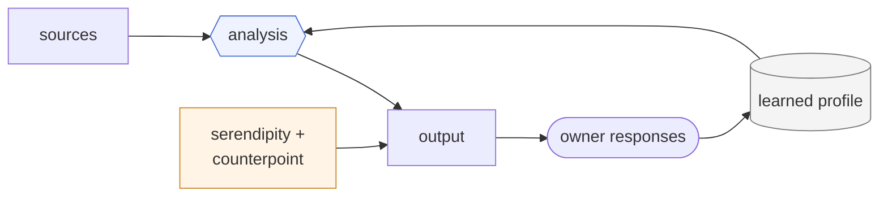

- Every domain runs this loop with its own sources and its own profile. The
  profile belongs to mini-moi, as files or in Postgres, never inside a model.
- "Owner responses" means more than a like: reactions, saves, comments, requests
  to go deeper, notes, replies.
- Every loop deliberately adds something the profile would not have chosen
  (orange). The domain figures show how.

**Curator:** RSS, web and X → AI ranking → learned preferences → daily briefing
→ reactions, Deep Dive requests, and observation responses.

**German and Portuguese:** sessions and transcripts → correction and analysis →
per-user progress and persona memory → next session → corrections accepted or
revised.

**Guild and Chief of Staff:** my requests, specifications, build
status and external signals → partner turns and scheduled loops → request
ledger, Board and decision store → drafts, briefings and proposals → approved,
revised, or refused.

The same shape appears across the five domains. The full
accumulate-and-synthesize loop is proven end to end in Curator (see *How
MiniMoi remembers*). Repetition across different domains is the evidence for
"platform over product." The two partner domains add a second shape in 1.2, work
directed and controlled rather than content learned (the first shape is a
feedback flywheel; the second is agent orchestration under human oversight).

---

## The Two Partners

The two partner domains each have one main agent: Master Craftsman (MC) in
Guild, and Chief of Staff (CoS). Each runs on its own runtime. Neither holds
mini-moi's provider keys. Each reaches mini-moi's data only through its own
turn-bound tools, the model gateway and the folders mounted into its
container, most of them read-only beside a few work folders of its own, and any write outside
mini-moi waits for my exact approval.

### How an approval works

**Figure 4. How an approval works**

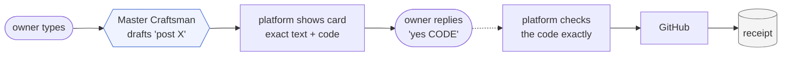

- **MC (AI)** understands, answers and drafts. It cannot post anywhere.
- **The platform (mini-moi's code, no AI)** turns the draft into a card with the
  exact text and a one-time code. It checks my own reply exactly, then acts and
  keeps a receipt with an operation id (`core/mc_tools/proposals.py`,
  `core/mc_tools/effects.py`).
- **Proven on production, 17 Nov:** a proposal posted a comment on issue 662,
  carrying its operation id.
- **Safety rule:** nothing reaches an outside system unless the platform sees my
  own message with the right code. The receipt, not MC's words, is the
  confirmation (#615).

Behind the card is the tiered policy (policy-as-code with code-enforced floors,
deterministic guardrails; appendix §6). It has about fifty rules in three tiers:
tier 1 reads; tier 2 runs private, reversible writes under standing rules; tier 3
needs my exact approval per effect, with a single-use grant, a fenced receipt and
a read-back verifier. Every call must also fall inside my live turn. An owner
Stop revokes in process first and then durably. Code floors mean the policy file
cannot lower a guest rejection, an issue write, an invitation, a deployment, a
repair, a delegation or a policy change below tier 3, and an invalid or missing
policy disables every tool. The policy is paired with an approval record that
pins its revision and digest; it is owner-approved and digest-pinned, not
cryptographically signed. It governs every MC tool. It does not cover the
runtime's own web search and read tools, or recall.

### Master Craftsman's runtime

**Figure 5. Master Craftsman's runtime**

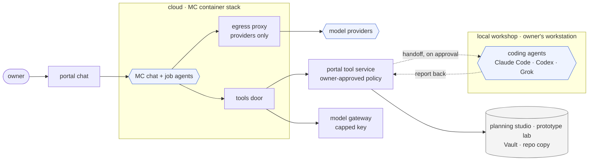

- **MC's own container stack** on an internal network, built from one image and
  deployed on a release tag (`docker-compose.mc.prod.yml`, with the 1.2 model
  layer in `docker-compose.mc-1-2-production.yml`). It holds no provider keys: it
  uses my signed-in plans where they fit, and metered models through the gateway
  on its own capped key. The route catalogue sends MC chat to the xAI routes.
- **Inside, one runtime hosts two agents:** one for the conversation and one for
  jobs (`docker/mc-agent-container/openclaw.json`).
- **Two ways out:** a proxy that reaches only model providers, and a fixed door
  into mini-moi's tool service and gateway. The portal reaches MC through one
  relay with no host port.
- **The tool service** checks every MC tool call against the
  owner-approved, digest-pinned policy, and only inside my live turn
  (`core/mc_tools/service.py`, `core/mc_tools/policy.py`).
- **Reads:** the planning studio (a read-only mirror), the Vault (MC's own
  filtered index), a repository copy at the deployed commit, GitHub issues and
  files, and its own past conversations. The prototype lab is 1.2 (beta) (#666). It also has its own
  web search on its own capped key, and fetches one public page per call through
  mini-moi (`core/mc_tools/web_fetch.py`).
- **Local workshop:** coding work is handed to agents on my workstation, only on
  exact approval and supervised; no standing runner is up, so it runs when I
  start it. They work there and report back.
- **Safety rule:** anything that writes outside mini-moi waits for my exact
  approval (figure 4).
- **It is not a sandbox.** The job agent can run commands inside its
  container. The protection is the network and tool limits.

**Depth.** The portal fixes a turn's route once when it admits the turn. Deep is
chosen only by my words ("think hard", "go deep"); light only for short plain
lines. A wrong light turn costs depth, never an action (`core/model_routes/depth.py`).

### Chief of Staff's runtime

**Figure 5b. Chief of Staff's runtime**

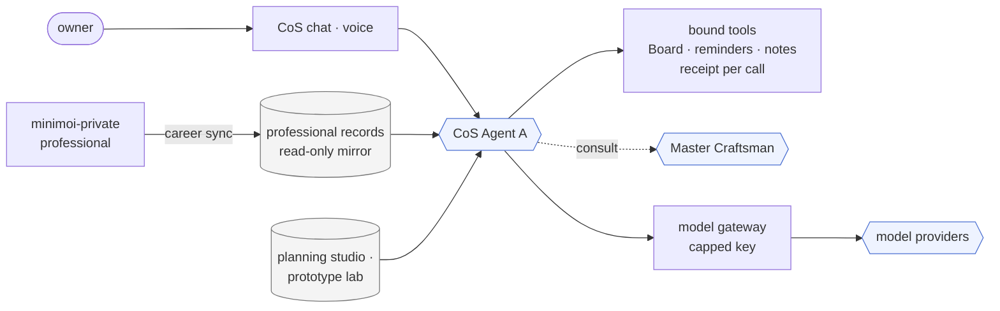

- **Bound tools:** every Board, reminder and note change goes through CoS's
  bound tools. Each change is tied to my turn and leaves a receipt.
- **Models:** a primary route with failover across providers. With its own
  capped key, which it has in production, CoS defaults to the xAI strong route;
  failover is one step to the same tier's API route
  (`docker-compose.minimoi-1-2-production.yml`).
- **Professional records** come from my private repository into a read-only
  mirror. That is live in production.
- **The planning studio and the prototype lab:** read-only when they arrive.
  Today CoS's planning studio copy is stale and the prototype lab is not
  readable; both are 1.2 (beta) (#666).
- **CoS sends a question to MC** when I ask, or say yes to its offer
  (`domains/cos/mc_send.py`). From voice that hand-off is 1.2 (beta) (#652).
- **Proven on production, 17 Nov:** a follow-up was saved as a Board item with a
  receipt and kept off MC's list. Dating it is #664.

**Current CoS implementation.** The platform owns authentication, session
identity, note mutation, policy, and the stable turn interface. Chat calls that
interface and reaches CoS Agent A, currently an OpenClaw container. OpenClaw is
the shell, not the domain: the name Agent A and the application-owned adapter
keep a future runtime swap from changing CoS. AWS Bedrock remains a later
provider option.

**Not a sandbox.** CoS's search adapter is narrow: it accepts a query rather than
an arbitrary URL, applies time and result limits, returns as many as 20 cited
sources, and treats their contents as untrusted evidence. The agent itself is
wider than the August document said. In its configuration the main CoS agent can
run commands, write and edit files, and fetch any URL, with the runtime's sandbox
off; its meeting and closed agents deny those tools. Agent A reaches files only
through the folders mounted into its container, and
reaches the platform only through typed tool calls bound to my turn. The adapter
is the documented runtime coupling point and is covered by tests so a runtime
upgrade cannot silently change its contract (agent sandboxing is the goal here,
not the claim; appendix §4, §6).

**The partner contract.** CoS follows a defined permission model: *propose
freely, act only through explicitly exposed capabilities, and require approval
where the capability says so.* In 1.2 it can converse, search with citations,
keep its store, set reminders, work its Board, and perform a fixed set of
effects under a grant. It cannot change the platform: domain data, deployments
and repository files are reached only through MC's tiered path, after my
approval.

**The partner identity is designed for useful disagreement** (honest pushback and
calibrated uncertainty, as the model specifications now ask; appendix §10). The
standing identity is short and live in production: direct, curious before
certain, comfortable saying "I don't know," and willing to disagree. It is not a
cheerleader and not a search engine with manners. Partner is a mode for
conversation and judgment; mechanical operations and raw scoring remain
accuracy-first.

**Scheduled loops.** CoS runs a daily build-discipline check, an hourly
guest-access check, a half-hourly host health check, the German and Curator
watches on Sundays, a novelty watch on the 1st and 15th, reminders every minute,
and a daily cost checkpoint that reports and never changes a budget or a route.
The career scout is off (`domains/cos/chief_of_staff.py`). Several loops still
evaluate fresh state without first reading accumulated memory; extending
Curator's accumulate-and-synthesize pattern to them remains the logical next
step.

**Validation.** A partner acceptance test is registered for MC: eight fixed
cases and a score sheet. Its baseline has been run but not scored. The founding
CoS document defines explicit success criteria, a two-to-three-week measurement
period, and a subjective but decisive question: does the interaction feel like a
working partner or a sophisticated tool? It also states the failure condition:
if the result is indistinguishable from a well-prompted neutral agent, robotic
agents are the better choice. Neither measurement has a result yet, so this is
not a partner 1.0.

---

## AI Usage Across the Platform

Two capabilities are still the clearest examples of AI use in the product loops:
Curator's path from daily reading into deeper research, and live voice
conversation in the language domains. The partner domains, described above,
add a second kind of AI use: agents that hold a conversation, call tools under policy, and
draft work for my approval. Each domain uses AI differently because the model
architecture is fitted to the job, not imposed uniformly.

### Curator: the mature, flagship pattern

**Figure 2a. Curator: the daily loop**

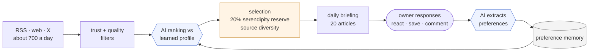

- **Filters** are fixed rules, with no model involved.
- **Ranking:** one model pass over the filtered pool, against the learned
  profile. A two-stage mode, a lower-cost pre-filter followed by a stronger
  ranking model, is available per run but is not the production default.
- **Selection** holds back a serendipity reserve, 20% by default and set in my
  preferences, and applies a source-diversity penalty, so one outlet never
  dominates (`domains/curator/curator_rss_v2.py`, `domains/curator/selection_rules.py`).
- **The loop is closed:** responses become scoring signals for the next day's
  ranking.

From the daily briefing, Curator also opens a longer research path, a ladder of
depths with a challenge pass at every rung (deep research with a devil's-advocate
role, and living review for the threads; appendix §11b).

**Figure 2b. Curator: going deeper**

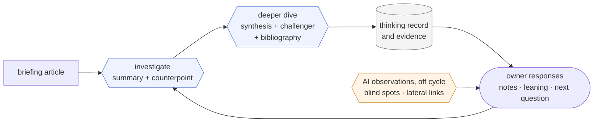

- **Investigate:** a summary plus a counterpoint: argument, implications,
  counterpoint, data, sources.
- **Deeper dive:** a synthesis, then a separate challenger pass (devil's
  advocacy, red team), plus a bibliography to follow up
  (`domains/curator/research/`).
- **Thinking record:** the question, my leaning, and the evidence for and
  against.
- **AI observations** run off cycle, daily after the briefing: blind spots in
  the coverage, source drift, and weekly lateral connections
  (`domains/curator/curator_intelligence.py`). The counterpoint comes from
  outside the briefing.
- Research intelligence lives here, inside Curator. It is not a separate domain.

Not every stored response closes an automatic loop yet:

| Response | Current path |
|---|---|
| Article reaction or comment | AI preference extraction → learned profile → future briefing scores |
| Research-thread direction shift | The next research session changes direction |
| Research-thread reaction or observation | Stored in thread history |
| Research-thread wrap-up | Thread closes with a conclusion |
| Response to an AI Observation | Stored in response memory; not automatically acted on yet |

**Model paths and cost.** Curator's model choices are evaluated for both cost
and output quality; a lower-cost model replaces another only when it meets the
required quality threshold. The per-capability table of models and costs that
earlier versions carried is left out here, because model versions and amounts
change too often for this document; OPERATIONS keeps them. Curator, like the two
language domains, calls its providers directly and sits outside the model
gateway; some model names in its code are a tier behind the gateway's routes.
Moving these paths onto the gateway is follow-up item 11 (#469).

**Local capability is deliberately retained.** The original
architecture ran local-model calls, and the development Mac still exercises a
live Ollama path. German implements a local translation fallback where a local
provider is available. Production does not run that provider, so the fallback is
not a production availability claim. Curator moved to cloud scoring after the
per-run cost of a suitable cloud model became negligible. One historical label
remains from that change: the scoring script's free-tier mode is still called
"ollama," although it uses keyword scoring rather than a live model.

**AI Observations** is the platform's clearest working example of accumulating
first and synthesizing later (reflection over a memory stream, and proactive
knowledge-gap navigation; appendix §1, §11b). Five observation types use model
tiers matched to their cost and complexity. They work across a rolling 30-day
baseline instead of reacting to a single day. The weekly higher-capability pass
reads the accumulated history and asks, in effect, *what has been thought about
this before?* This is also where the thinking-record goal becomes concrete.
Observation responses, Deep Dive motivations, and reactions are the raw material
of that record.

**Current model selection.** The production cron passes `--model=configured`,
which reads `CURATOR_RANKING_MODEL`; any value it does not know fails validation
instead of silently selecting a default. The provider-reported effective model
is written to the cost record, and the briefing stores the resolved model name.

**Multi-model challenge capability.** Curator's Deeper Dive closing path uses a
first synthesis, a cross-provider challenge (multi-agent debate with
heterogeneous models; appendix §11b), a final review of that challenge, and a
closing counter-analysis. The middle two calls use Guild's shared
`ChallengerService`; the surrounding calls remain in the Research Intelligence
generator. The overlapping mechanisms still need consolidation under one name
and one maintained implementation.

**Known Deep Dive regression.** Several generation scripts coexist while the
frontend offers Scans, Deep Dive, and Deeper Dive as related but distinct options.
At least four candidate scripts existed at the last count. Some may represent
real duplication; others may support genuinely different features. The paths
need to be traced before cleanup begins. This is regression refactoring, not a
redesign.

### German and Portuguese: one experience, converging implementations

**Figure 3. German and Portuguese**

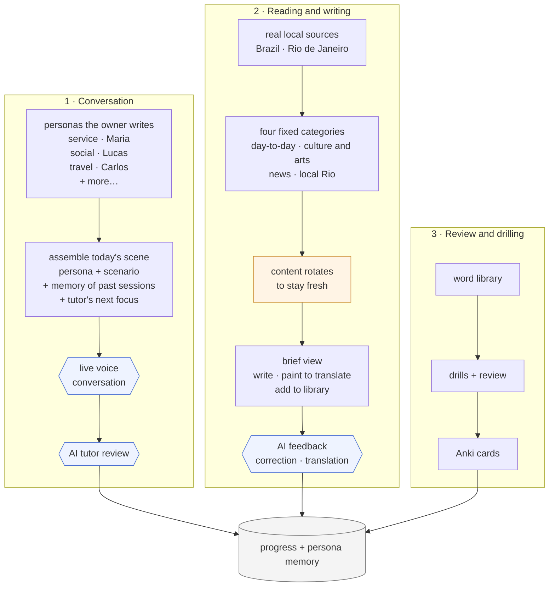

- The example is Portuguese. German works the same way, with Austria and Vienna
  as its local scene.
- **Conversation:** I write the personas; there is no fixed menu. Maria is a
  padaria attendant (a short service exchange). Lucas is a friend of a friend at
  a pizzeria (a social introduction). Carlos is an Uber driver (travel). Each
  session's scene is assembled fresh from the persona, a scenario, the persona's
  memory of past sessions, and the tutor's focus for next time
  (`domains/german/german_domain.py`, `assemble_session_prompt`). Practice aims
  at the gaps.
- **Reading and writing:** real local sources in four fixed categories. Content
  rotates within each category, so interest holds. From a brief view I write,
  paint a word to translate it, and save phrases to the library. AI feedback
  follows.
- **Review and drilling:** saved phrases feed the word library, then drills and
  review, then Anki cards.
- German state is files; Portuguese sessions are in Postgres. Same experience,
  converging code.

German and Portuguese present the same core experience over deliberately
different first-stage implementations. Portuguese extended the language domain
through a practical copy-and-adapt approach rather than a redesign. Its narrower
initial scope emphasized the frontend, in-website voice, multi-user separation,
and quick evaluation by real users. German retained the more setup-intensive
automated review, Anki, lesson-plan, and mobile voice paths. The two are
converging around whichever approach proved stronger: Portuguese has a
Postgres-backed translation cache, while German has a three-tier translation
fallback and a stronger transcript-review tier. A third language will inherit
the resulting shared pattern rather than either first implementation unchanged.
Both translate through DeepL, and the translation choice is still hard-coded in
both.

**Voice conversation has delivered the greatest practical value in the language
domains.** Unscripted exchanges preserve the parts that scripted exercises
remove: hesitation, getting stuck, using filler sounds, recovering, and
continuing the interaction (interactional competence and repair, the part the
2026 studies find most AI partners lack; appendix §11a). Real interactions can
also be recreated afterward as scenarios, turning a difficult exchange into
preparation for the next one.

Live persona conversation needs a model that understands the prompt and speaks
the language fluently. That combination remains difficult, and quality from one
provider can vary even within a single day. The model choice is therefore
surfaced in the UI, with one default and other providers one click away. The
learner is the first to notice a drop in fluency and is best placed to switch.
German and Portuguese were the first users of the shared realtime voice path and
remain its production UI (figure 8).

The transcript pipeline separates concerns. Deterministic parsing normalizes the
transcript first. A strong model then analyzes it and produces feedback. On
German's automated path, the analysis has concrete downstream effects: Anki card
generation, the next lesson plan, and progress tracking.

**Model choice is split between the interface and the backend.** Voice and
review model choice are personal and visible at the point of use. Translation is
not; it should be selected quietly in configuration. Moving it there is planned
after the implementations converge.

**Language reading should be engaging, varied, and contemporary.** It combines
language practice with cultural exposure rather than following a textbook
sequence. This requires freshness, variety, and source balance, but not
Curator's full ranking apparatus. The language domains use a simpler
source-variety cap because it better fits their purpose. Language learning is
closer to learning an instrument than solving a decision problem; progress is
felt through practice.

---

## How the agents work together

I work with two partners and a few other agents, and I want each to do one kind
of work well without stepping on the others. MC is the design and build partner;
CoS is the thinking partner. Each has one helper for small, read-only jobs, and
a helper hands back drafts, never actions. When MC needs real coding or research
done, it hands the work to the coding agents on my workstation (Claude Code,
Codex, Grok), only after I approve the exact request, supervised, and they report back.
When I ask, or say yes to its offer, CoS sends a question to MC. When I want both at once, I meet
them in Guildhall: a message to no one gets one answer, and "both of you" asks
both.

One rule ties this together. An agent can draft anything, but only the platform
acts, and only when it sees my own reply to a card showing the exact text and a
one-time code (figure 4). Every action leaves a receipt, and the receipt, not
the agent's words, is the confirmation. There is no path by which one agent
grants another authority.

### Guildhall: meet with your Guild

**Figure 7. Guildhall: meet with your Guild**

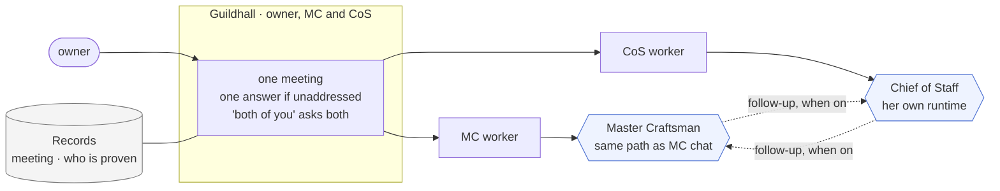

- **The three of us meet in one room.** Each partner answers as itself, through
  its own runtime, with the same tools and policy as in its own chat.
- **A message to no one** gets one answer, picked by rules, with no model call.
  "Both of you" asks both (`domains/records/meetings.py`).
- **Records keeps the meeting** and knows which partner has proven it can answer
  there. A partner is proven by one committed reply in a proof meeting; an
  unproven one is refused ("Prove first"). Records is the foundation, not a
  domain. It runs on SQLite, not Postgres.
- **Follow-ups between MC and CoS** sit behind a switch that is off in
  production today (#548).
- Guildhall and Records are opt-in compose files by design, and both are on in
  production today.

*Guildhall meeting harness.* The 2 November design addition is implemented and
running in production. It resolves natural addressing, schedules independent
replies or explicit question-and-answer dependencies, and preserves who actually
said what (multi-agent group chat with speaker selection and handoffs; appendix
§5). I can send corrections while agents are working; a newer message of mine
supersedes the unclaimed turns of an earlier round. Live interruption of an
action already running has not been proven.

Each partner has a small always-on worker that stands in for it in meetings: it
accepts an invite only if Records says that partner is proven, picks up turns
addressed to it, gets the answer from the partner and posts it back. MC answers
named turns through the same path as MC chat; peer discussion is a separate,
tool-free call (`services/rooms_worker/`). The workers run apart from the
portal, so CoS keeps answering in meetings if the portal goes down. In
production MC's named turns go through the portal, so MC does not. Automatic discussion must not replay my original action
request or gain new tool authority.

The standalone
[Guildhall Meeting Flow and Etiquette specification](docs/specs/spec_guildhall_meeting_flow_2026-11-02.md)
defines the rules and acceptance examples. Its "one automatic follow-up per
recipient" limit has not been traced to a constant in code and should be read as
specification text until it is. The spec cites group-chat orchestration and
A2A's message and task distinction as related patterns; it does not claim
protocol compatibility.

### Helpers

**Figure 10. Helpers**

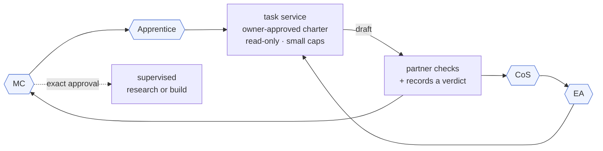

- **Each partner has one helper:** the Apprentice for MC, the EA for CoS
  (`services/helper_seats/`).
- **Helpers work under a versioned charter I approved:** read-only tools, and
  small per-task and daily caps (`config/partnership/charters/`).
- **Helpers hand back drafts, never actions.** The partner checks each draft and
  records a verdict before using it. Every handoff is a record in the
  partnership task service, a single-writer, hash-chained journal, so who drafted
  what and who accepted it can always be shown (`services/partnership_tasks/`).
- **Bigger research or build work** goes to supervised delegation, only on my
  exact approval.
- **Safety rule:** a helper never acts on the world and never speaks to me. A
  charter that lists anything but read-only tools refuses to start.

### The request ledger and delegation

Build and review requests to the coding agents are files, not chat. One folder
per request: an immutable request and an append-only event log (event sourcing;
the task lifecycle described in A2A's vocabulary, without the A2A protocol
itself; appendix §5). The recipient's watcher picks it up and writes a receipt;
progress, a result, or a "needs you" event for the supervisor follow. Delivery
is at least once with deduplication. A receipt means a session picked it up, not
that work was done; a result is the worker's report, not verification; nothing
in the ledger approves anything or runs a model (`core/agent_requests/`). An
automated connection manager with provider adapters exists as scaffolding and is
not started by anything in the repository.

Delegated research and build jobs are tier 3: they start only on my exact
approval, in a fresh workspace with no push, claimed by a runner on my
workstation, and every real route is supervised (`core/mc_delegation_dispatcher/`,
`core/mc_delegation_runner/`). No standing delegation runner is up; delegated
work does not run unattended.

---

## How MiniMoi remembers

Memory in mini-moi is built by everyone who takes part, not only by the model I
happen to be talking to. Builder sessions with Claude Code, Codex and Grok,
conversations with MC and CoS, Guildhall meetings, and chat exports I drop in
all land on one shelf of plain files, the Vault. A source captures nothing until
I approve it, and sync never deletes.

MC searches the shelf through its own filtered index, and CoS has an ask service
beside it. Keyword search works in production today. Meaning search, which finds
a note even when the question is worded differently, runs on my workstation and
Dev, and comes to production in 1.2 (beta) (#660). The shelf has its own
encrypted backup; the scheduled daily run has failed since 12 November and is
being fixed (#667).

Beside the Vault there is an append-only register for the small decisions I
settle in chat, CoS's store and full conversation history, MC's recall of its
own past chats, and persona memory in the language domains.

### The Vault

**Figure 6. The Vault**

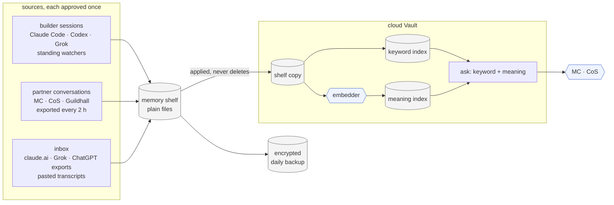

- **Every participant contributes:** builder sessions, partner conversations,
  and chat exports. A source captures nothing until I approve it; its first run
  is a dry run that lists counts only. Grok CLI sessions are 1.2 (beta) (#668).
- **The shelf is plain files,** with front matter and immutable editions. My
  workstation (today a Mac) holds the master and is the only writer. Capture runs
  every two hours while the workstation is awake. Sync never deletes.
- **The cloud copy** is applied, read-only, and updated incrementally every
  fifteen minutes. A failed update leaves the old copy serving. Conversations
  held in production travel back encrypted and are captured on the workstation
  under the same approval gate (`core/memory_sync/`).
- **The embedder** is a small pinned model. It turns each note into numbers that
  capture its meaning, so a question worded differently from the note still
  finds it (`core/memory_index/embedder.py`). Production today has keyword search
  only; in the 1.2 end state the embedder runs in the cloud Vault, beside search,
  and does not depend on the workstation: 1.2 (beta) (#660).
- **The meaning index holds no note text;** every hit re-reads the file. One ask
  procedure answers every caller the same way, keyword and meaning results in
  two labelled lists, never blended, with citations back to the file and lines
  (`core/memory_ask/`).
- **Backup:** encrypted, with a restore drill in code (`core/memory_backup/`).
  The scheduled daily run has failed since 12 November (#667); a hand backup ran
  on 17 November. A small portable reader can list, search,
  export and restore the shelf with nothing else from mini-moi
  (`core/vault_t1/`).
- **Safety rule:** each partner sees only what it is allowed to see. MC searches
  its own index, built through a privacy filter that holds out CoS conversations
  and other private material, and reached only through the portal's tools door
  (`core/memory_index/mc_index.py`, `core/mc_tools/vault_search.py`). CoS has its own
  ask service in production; which CoS conversations consult it is set on the
  host.

The workstation role is a design choice, not a Mac choice: capture, indexing and
publishing belong on the machine I work at. Today that machine is a Mac, and the
implementation is bound to it in three places: the scheduled jobs are launchd
definitions, the dev secret chain reads the macOS Keychain, and the embedder is a
local Ollama. The Dev host already runs the same feed as a systemd timer, so the
Linux path exists; making the workstation role portable is follow-up item 16.

### Other memory

- **The notes register.** Short notes on what I settle in a direct chat with any
  agent. Append-only and hash-chained (`core/mc_notes/register.py`). Agents write
  to it from the command line, and MC's voice walk reads it. It is not yet wired
  into chat in general. Notes need no approval card.
- **MC's lessons.** An append-only, hash-chained ledger of guidance I adopt,
  which shapes later answers and is never authority over policy
  (`core/mc_lessons/`).
- **The CoS store and history.** Goals, plans, obligations and decisions through
  one command writer with receipts; every CoS conversation kept and reloadable
  (`domains/cos/store/`, `domains/cos/history.py`).
- **MC recall.** MC can recall its own retained conversations.
- **Persona memory.** In the language domains, each persona remembers past
  sessions and the tutor sets the next focus.

### The learning loop

Curator is the only fully proven instance of the learning loop today. Reactions
update a learned profile, the dispatcher injects that profile into the next
scoring run, and a weekly higher-capability pass reads 30 days of accumulated
observations to identify what changed. The argument for the pattern is not only
cost. Cheaper models with accumulated context can outperform more expensive
models that lack it.

The idea predates the current memory work. The March 2026 production roadmap
proposed a vector-indexed store so "every LLM call retrieves relevant personal
context." It framed the work around the same question Curator's weekly pass asks
today: *what has been thought about this before?* The Vault is a more mature
version of that idea, informed by production use.

What is not yet done is the periodic higher-capability pass that reads the
partners' records and asks what changed, what was decided but not completed, and
what pattern no single day reveals. The language domains remain the deliberate
exception: practice is not a decision problem.

---

## Voice

**Figure 8. Voice**

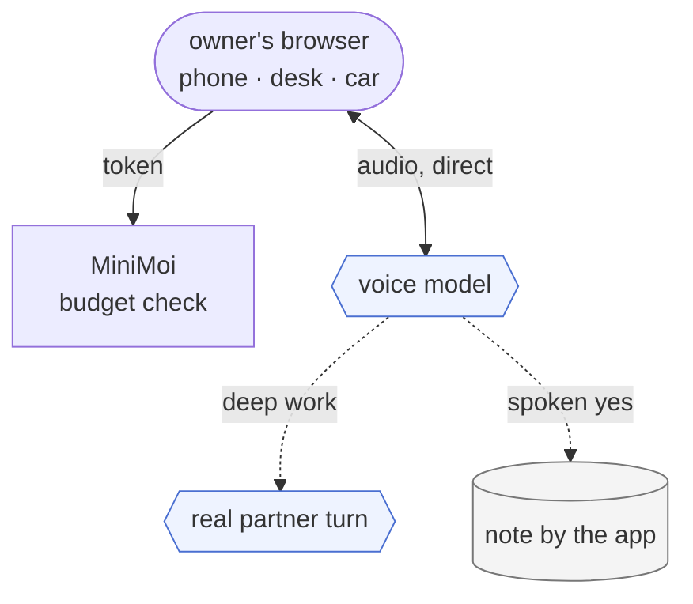

- **The browser gets a short-lived token** from mini-moi, after a budget check,
  and talks to the voice model directly (`core/realtime_voice/bootstrap.py`).
  Audio never passes through mini-moi, and the provider key never leaves the
  server.
- **Light talk** is answered by the voice model itself. **Deep work** goes to the
  real partner turn, with the same power as typed chat. Today CoS does; for MC it
  is 1.2 (beta) (#659, #662).
- **Notes** are written by the app, only after my spoken yes. Exact approvals
  still use the card and code (figure 4).
- **I choose the voice model,** the same way as every model (figure 9). The
  choice follows me on every device: 1.2 (beta) (#659, #661, #662).
- German and Portuguese tutoring use the same voice core.

**Where production is today.** German and Portuguese tutoring is the production
voice UI. CoS's direct voice consults her desk, the real CoS agent
(`domains/cos/direct_voice.py`). MC's voice is a lighter "walk": the voice model
speaks as MC, with a slim persona and three read tools (notes, deploy status,
issues), and the full MC is not called during the call. A task I confirm on a
walk is saved as a note that a later MC turn acts on
(`minimoi_portal/guild_ui/mc/voice_walk.py`) (#659, #662). Handing a CoS voice
question to MC is 1.2 (beta) (#652). Deep work to the real partner from
both voices is the 1.2 (beta) end state above. MC and CoS voice run under a daily
budget reserved before any provider call; German and Portuguese have a rate
limit and a session timer instead (`core/realtime_voice/budget.py`). The spoken
yes stops accidents. It is not authentication.

---

## Models and the Shared Gateway

**Figure 9. How models are swapped**

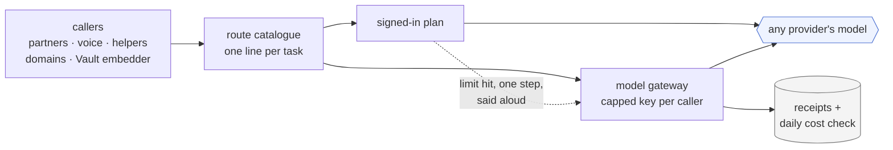

- **Callers ask for a task, not a model.** The route catalogue
  (`core/model_routes/catalogue.json`) says which route serves each task, so
  swapping a model is one line. For the partners and helpers, no model, runtime
  or provider is bound into the code; the learning domains still name theirs in
  code until #469.
- **Plan logins where they fit, a capped key for the rest.** Metered calls from
  the partners and helpers go through one gateway (LiteLLM,
  `services/model_gateway/litellm.prod.yaml`) on each caller's own capped key.
  Each key is limited to named routes, with a spend cap and a rate limit;
  production setup refuses to mint a key without a cap.
- **A plan switch is one step and is said in the answer.** Showing a gateway
  fallback on screen as well is 1.2 (beta) (#658).
- **Receipts and a daily cost check** show what ran. Every call leaves a
  sanitized receipt with no content (FinOps for AI; appendix §7). The check
  reports; it never changes a route. It warns on a high fallback rate or an
  unpriced call. Spend alerts are #657.
- **The learning domains** move onto the same gateway (#469). Today Curator,
  German and Portuguese still call their providers directly.

**Figure 9b. Model choice and fallback**

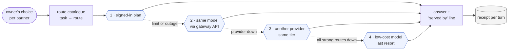

- **I choose the model per partner.** The route catalogue turns each task into a
  route.
- **In the 1.2 end state each turn steps down in order:** the plan; the same
  model through the gateway; another provider at the same tier; a low-cost cloud
  model as the last resort. Every step is announced ("served by …") and kept in a
  receipt. A fallback is never silent.
- **Where production is today:** a plan turn that hits its limit before any tool
  ran moves one step, to the same tier's API route, and says so in the answer
  (`core/model_routes/__init__.py`). Inside the gateway a role can fall back to
  another provider at the same tier; those fallbacks are recorded in receipts and
  counted in the daily report, but not yet shown in chat (#658). A plan never
  falls back silently inside the runtime, and no switch crosses billing quietly.
- **No local model in production.** Local models stay on Dev and staging for the
  regression run before a major release.
- **The goal is an open-source model** that can do the job. When one passes the
  same tests, it becomes a route in the catalogue, one line, like any other.

---

## How 1.2 Is Structured

### Runtime topology

Production is one modest AWS EC2 instance, with Cloudflare in front through a
tunnel to the host and nginx on the host. Images are built in CI, pushed to a
private registry, and pulled by tag. A base compose file defines ten always-on
services: PostgreSQL, the model gateway, CoS Agent A, Curator, German,
Portuguese, the portal, a system bot, the CoS bot and the CoS scheduler. The
1.2 additions are opt-in by design, and all of them are on in production today:
the partnership task service and its worker, the two helper seats, the CoS
Board, Records and the Guildhall workers in separate compose files, and the
supervisor and the Vault's two ask services as profiles of the base file. MC is
its own compose project (figure 5),
deployed on a tag rather than on a push to main; the portal is pointed at it
with a `switch` command, and rolling back to CoS as the chat partner is the same
command. One operator script binds secrets, database roles and keys for the 1.2
layer and refuses to run without an approval variable.

Dev and staging run on a second, smaller EC2 instance with the same base file
plus an override. My workstation (today a Mac) holds the Vault's master shelf,
the host-side runner for delegated work, and a standby stack that is mostly off.

Backups run daily, a local copy plus an encrypted off-site copy that includes
both databases, with a weekly second copy.

### Delivery

A push to main is classified by the paths it touched: documents only, one
domain, or the full release of nine application services (path-to-production
mapping; appendix §8). A documentation-only change restarts nothing. The test
job runs a key-docs check and then a focused or sanity set with a PostgreSQL
service; images are built and pushed; the host pulls the tag and restarts only
the selected services, waiting on container health. The whole suite runs nightly
and files an issue on failure. Dev has a delivery record written only after a
verified deploy or rollback (provenance, blue/green with guarded rollback;
appendix §8); production has a deployment observation per service and an
authored notes file, not yet a record per release.

---

## Identity, Security & the Multi-Agent Working Model

Every domain sits behind a single portal. The portal owns session authentication
and forwards identity to the appropriate backend. Domains never trust identity
sent directly by the client. A July 2026 security review found and closed cases
where a missing identity was treated as "match everything" rather than "match
nothing." Details of the exposure remain outside this public document. The
architectural lesson belongs here: nothing shipped without review, including the
fix.

The multi-agent working model also separates roles. I approve every deployment;
the pipeline deploys a merge to main after tests pass, so the gate is my go,
recorded in the working rules, not a code gate. Other roles handle design and
specification, implementation and deployment, memory and coordination, and
independent review. The agent in any role may change over time. The roles are
the durable structure.

In 1.2 the controls are mechanisms as well as rules: the tiered, owner-approved
policy (figure 4); a capped gateway key per agent; a portal-signed assertion
naming one subject for one exact request on what the portal forwards to CoS and
the task service; a turn binding on every MC tool call (agent identity in the
zero-trust sense; appendix §6); and a supervisor container that reports what has
stopped and what is waiting on me, and approves nothing on my behalf.

Claude Code, Codex and Grok all do build work within the same specification,
review, and approval workflow. Every non-trivial change is reviewed by an agent
other than the one that wrote it, usually from a different provider, as a
standing rule; the
2026 studies on cross-model review support it, with the proviso that the
reviewer must be strong, not merely different (appendix §11c). Adding a coding
agent changes who can perform implementation; it does not change the authority
or review requirements attached to the role.

---

## Open Design Questions

Stated plainly rather than resolved by default:

**Does the platform depend on its current agent runtime, or does the runtime
depend on the platform?** The March 2026 platform document states the latter.
Both partners run on OpenClaw today behind mini-moi's tool service and gateway.
A second runtime has not been tried, so portability is a design claim, not a
tested one.

**Is the multi-model challenge pattern in Curator's Deep Dive pipeline the same
mechanism as Research Intelligence's Synthesizer+Challenger framework and Guild's
`ChallengerService`?** If so, one real capability deserves one name and one home.

**How much should the partners see of each other?** Today MC's Vault index leaves
CoS conversations out by default, and automatic follow-ups between them are off.
Opening either is a small configuration change, but it should follow evidence
from daily use.

---

## Ongoing and Planned Follow-Up

1. **Instrumented live session.** Run a real end-to-end session with monitoring
   and document which code paths execute, what they do, and which paths never
   fire. Exercise the local-model path on the Mac standby and in the staging
   regression run; production does not claim a local fallback.
2. **Confirm or rule out** whether Curator's Deep Dive pipeline, Research
   Intelligence's `domains/curator/research/scripts/generate_dive.py`, and Guild's `ChallengerService` are the
   same underlying capability.
3. **Re-verify** the purpose of Curator's three coexisting Deep Dive-family
   scripts (Scans, Deep Dive, and Deeper Dive) before writing a cleanup spec.
4. **Correct the Curator model override.** Closed: the override is validated
   and unknown values fail. The remaining gap is item 11.
5. **Correct `docs/LLM_REGISTRY.md`.** The current registry is silent on CoS, Guild,
   and Portuguese; undercounts German; omits TTS; and overstates which model
   handles German's user-selectable review path.
6. **Converge German and Portuguese.** Normalize both implementations in both
   directions before building French on the same template.
7. **Move translation model choice into backend configuration.** Apply the
   change across both language domains after item 6.
8. **Exercise runtime swap boundaries.** OpenClaw now depends on the platform's
   interface. Prove that contract through upgrades and, later, a second runtime
   implementation before claiming full runtime portability.
9. **Build and measure the CoS partner layer.** Once the partner is in daily use,
   run the founding two-to-three-week measurement. Compare before and after,
   track novel suggestions, and make the explicit "partner or tool" judgment.
10. **Keep the per-domain flow diagrams current** as implementation changes. The
    durable user and operational flows belong here; detailed call graphs remain
    in the feature briefs so they can update on their own schedule.
11. **Move Curator, German and Portuguese onto gateway routes** so their model
    choice, failover, receipts and cost sit with everything else (#469).
12. **A delivery record per production release**, as Dev already has; today
    production keeps a deployment observation per service and an authored notes
    file.
13. **Trace or add the Guildhall follow-up limit** in code.
14. **Measure both partners in daily use.** The founding "partner or tool"
    question from item 9 applies to MC as well as CoS; MC's acceptance baseline
    needs scoring.
15. **A named, specification-led delivery lifecycle for the platform's own
    work**, with MC as its keeper (spec-driven development, AI-DLC; appendix §8).
    In design.
16. **Make the workstation role portable.** The Vault capture, index and publish
    jobs, the delegation runner and the dev secret chain assume a Mac (launchd,
    Keychain, local Ollama). A Linux workstation should run the same role with a
    systemd timer, a different secrets backend and the same embedder contract;
    only the coding-agent sign-ins should need configuring.
17. **The 1.2 (beta) fast follows.** Each figure above shows the
    end state; these close the gaps it names:
    - meaning search in production, with the embedder in the cloud Vault (#660);
    - voice parity: deep work to the real partner from voice, and my model choice
      following me on every device (#659, #661, #662);
    - gateway fallback shown on screen (#658);
    - spend alerts in the gateway cost policy (#657);
    - dated Board items for CoS (#664);
    - the prototype lab readable by both partners (#666);
    - the daily Vault backup working again, failing since 12 November (#667);
    - Grok CLI sessions captured into the Vault (#668).
