# mini-moi

*1.2 beta, November 2026.*

mini-moi is a personal AI agent platform. It carries context across reading and
research, language learning, and the work of building and running the system
itself. It remembers my interests, what I have already investigated, how my
thinking develops, what I decide to follow up on, and what I got wrong.

The same pattern applies beyond one person. Persistent context and feedback can
help teams, organizations, and their systems learn and improve over time. This
repository is the personal version.

mini-moi has been in daily use since February 2026 and on AWS since June 2026.
Release 1.2 went to production as a beta on 9 November 2026. This repository
documents the system as it works today, with current capability kept distinct
from planned work. Where the 1.2 end state is ahead of production, I say
**1.2 (beta)** and name the open issue. [ARCHITECTURE.md](ARCHITECTURE.md) is the
reference; this page is the short form of it.

---

## Current state (1.2 beta, November 2026)

Five user-facing domains. Two are partner domains, formalized in 1.2, where
agents and I work on the platform and on my own priorities. Three are the
learning domains the platform grew from.

| Domain | What it does today |
|---|---|
| **Guild** | Design and build. Master Craftsman (MC), the main agent of my Workshop, works here and is live in production by chat, and by voice as a lighter walk until voice parity in 1.2 (beta) (#659). It coordinates the coding agents that build mini-moi, judges what comes back, and acts only through mini-moi's tools under a policy I approved. |
| **Chief of Staff** | My thinking partner across all of mini-moi, live in production by chat and voice. It keeps my goals, plans, decisions, reminders and a Board, watches on a schedule, and pushes back. |
| **Curator** | Daily reading and sustained research. Each morning it ranks about 700 candidates from international RSS feeds, X bookmarks, and theme-driven web search down to 20, with a serendipity reserve against a closed loop. Selected articles become investigations, deeper dives with a separate challenger pass, and a thinking record. Research intelligence lives here. |
| **Mein Deutsch** | German immersion that began with a trip to Vienna and no chance to speak beforehand. AI personas I write, in everyday scenes, hold unscripted voice conversations adapted to what I can manage. Reading (Lesen) and writing with correction feed the same loop, and each session shapes the next. |
| **Meu Português** | The same design for Brazilian Portuguese, for a family with different levels. Each person keeps a separate learning record; nobody is sorted into a level. |

Records and Guildhall are foundations, not domains: Guildhall is the room where I
meet both partners, and Records keeps those meetings.

---

## What is new in 1.2

The August release was a beta with one agent inside the product. Since then the
solution has changed shape. Three changes define 1.2.

**1. Two AI partners, live in production.** Master Craftsman and Chief of Staff,
each on its own runtime, reachable by chat and voice, each acting only through
its own tools bound to my turn. MC's voice is lighter today; see item 6.

**2. Agent coordination.**
- **Guildhall:** MC, CoS and I meet in one room. A message to no one gets one
  answer; "both of you" asks both. Records keeps the meeting and knows which
  partner has proven it can answer there.
- **Helpers:** each partner has one helper (the Apprentice for MC, the EA for
  CoS) under a charter I approved, with read-only tools and small caps. Helpers
  hand back drafts only, and the partner records a verdict before using one.
- **Delegation:** bigger coding or research work goes from MC to the coding
  agents on my workstation (Claude Code, Codex, Grok), only on my exact approval,
  supervised, and they report back.
- **One approval model:** a card with the exact text and a one-time code. Only my
  own reply acts, and a receipt is kept. The receipt, not the agent's words, is
  the confirmation.

**3. Memory that every participant builds.**
- **The Vault:** builder sessions (Claude Code, Codex, Grok), partner
  conversations (MC, CoS, Guildhall) and chat exports (claude.ai, Grok, ChatGPT)
  land on one file-first shelf. A source captures nothing until I approve it, and
  sync never deletes. MC searches its own index, built through a privacy filter;
  CoS has its own ask service, and which CoS conversations consult it is set
  on the host.
- **Search:** keyword search works in production today. Meaning search in
  production, with the embedder beside the Vault, is 1.2 (beta) (#660). Grok CLI
  capture is 1.2 (beta) (#668).
- **Other memory:** an append-only register of the decisions I settle in chat,
  CoS's full conversation history, MC's recall of its own chats, and persona
  memory in the language domains.

And three smaller ones.

**4. Governance you can check.** An owner-approved, digest-pinned policy of about
fifty rules in three tiers is checked on every MC tool call; CoS acts through a
fixed set of turn-bound tools. There is a receipt per call, a capped key per agent, and a daily cost check.

**5. Model choice without lock-in.** Callers ask for a task, and a route
catalogue maps tasks to models, one line per task. Plan logins where they fit, and
a capped gateway key for metered chat, which is the partners' default today. A
plan switch is announced in the answer; gateway fallbacks show in receipts, and
on screen in 1.2 (beta) (#658). There is no local model in production. Curator
and the language domains still call their providers directly; moving them onto
the gateway is #469.

**6. Voice with the same power as text.** The browser talks to the voice model
directly, deep work goes to the real partner, and notes need my spoken yes. My
voice model choice follows me on every device. This is 1.2 (beta) (#659, #661,
#662). Today German and Portuguese tutoring and CoS's voice use the full path;
MC's voice is a lighter talking session that can read notes, issues and deploy
status.

[ARCHITECTURE.md](ARCHITECTURE.md) has the figures behind each of these, and two
longer sections:
[How the agents work together](ARCHITECTURE.md#how-the-agents-work-together) and
[How MiniMoi remembers](ARCHITECTURE.md#how-minimoi-remembers).

---

## The two partners

**Guild** is the platform's workshop, where specs become build items and Claude
Code, Codex and Grok do the build work. **Master Craftsman (MC)**, the main
agent of my Workshop, is the front door for build and operations requests. It
takes my words, writes them into a request ledger the coding agents pick up, and
judges what comes back. It posts outside mini-moi only after my exact approval.
Bigger coding or research work goes to the agents on my workstation, also only
on exact approval, and supervised. MC runs in its own container stack with no
provider keys. It has one helper, the Apprentice.

**Chief of Staff (CoS)** is a working partner, not an executive assistant. It
should keep the reasoning behind decisions, not only the task list; watch across
domains; bring up relevant things I did not ask for; and disagree when the
evidence points away from the easy answer. Every change to its store, reminders
and Board goes through a bound tool with a receipt. It reads my professional
records through a read-only mirror, and sends my question to MC when I ask or
say yes to its offer. Its model work runs in its own container behind a stable
interface, on its own capped key. It has no write access to mini-moi's code or
release scripts. It has one helper, the EA.

### How an approval works

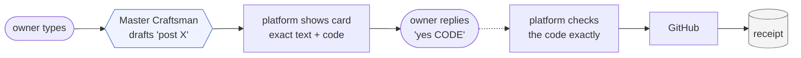

- **MC (AI)** understands, answers and drafts. It cannot post anywhere.
- **The platform (mini-moi's code, no AI)** turns the draft into a card with the
  exact text and a one-time code. It checks my own reply exactly, then acts and
  keeps a receipt.
- **Safety rule:** nothing reaches an outside system unless the platform sees my
  own message with the right code. The receipt, not MC's words, is the
  confirmation (#615).

### Master Craftsman's runtime

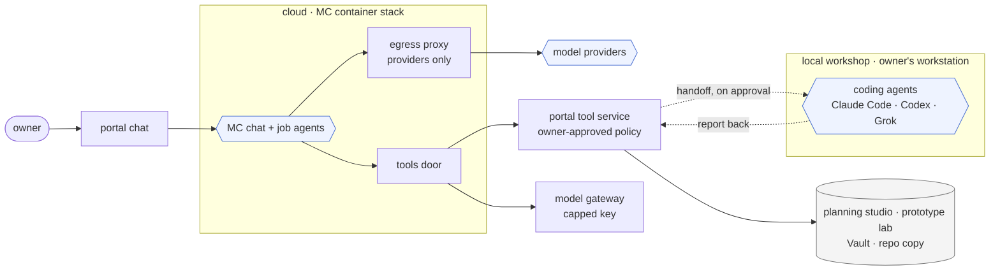

- **Its own container stack,** with no provider keys. It uses my signed-in plans
  where they fit, and metered models through the gateway on its own capped key.
- **Two ways out:** a proxy that reaches only model providers, and a fixed door
  into mini-moi's tool service and gateway.
- **Reads:** the planning studio, the Vault through its own filtered index, and
  a repository copy at the deployed commit. The prototype lab is 1.2 (beta)
  (#666).
- **Local workshop:** coding work goes to the agents on my workstation, only on
  exact approval and supervised. They work there and report back.
- **It is not a sandbox.** The job agent can run commands inside its container.
  The protection is the network and tool limits.

### Chief of Staff's runtime

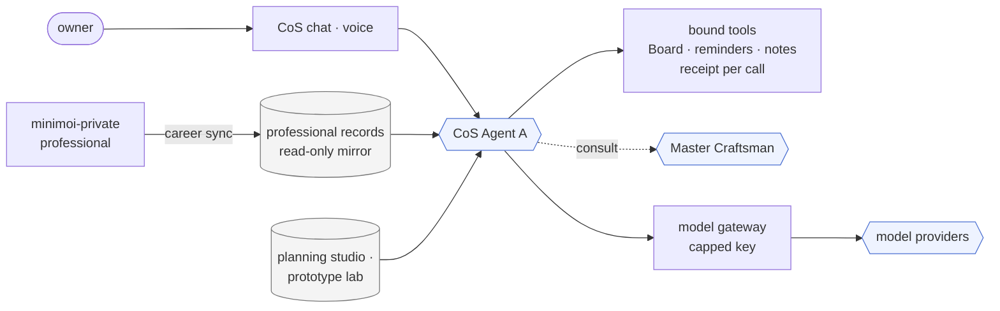

- **Bound tools:** every Board, reminder and note change goes through CoS's
  bound tools. Each change is tied to my turn and leaves a receipt.
- **Professional records** come from my private repository into a read-only
  mirror.
- **The planning studio and the prototype lab** are 1.2 (beta) for CoS (#666).
- **CoS sends a question to MC** when I ask, or say yes to its offer. From voice
  that hand-off is 1.2 (beta) (#652).

[ARCHITECTURE.md](ARCHITECTURE.md#the-two-partners) has the detail behind these
three figures, and the figures for Guildhall, the helpers, the Vault, voice and
the model gateway.

---

## Two product loops

Curator and the language domains are the clearest expressions of the product.
One turns daily reading into a continuing research practice. The other turns an
unscripted conversation into material for the next session.

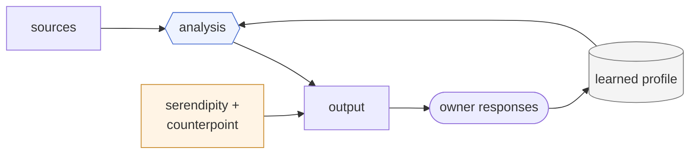

Every figure uses one key: hexagons and blue boxes are model calls, cylinders
are stored data, and orange marks deliberate variety, the rule that keeps a
learned profile from becoming a closed loop.

### Curator: from reading to research

A selected article can remain a quick read, contribute feedback to later
selection, or become the starting point for a longer investigation.

**The daily loop**

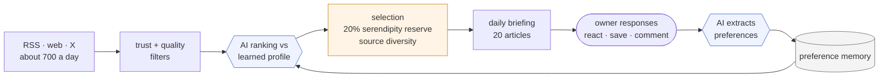

**Going deeper**

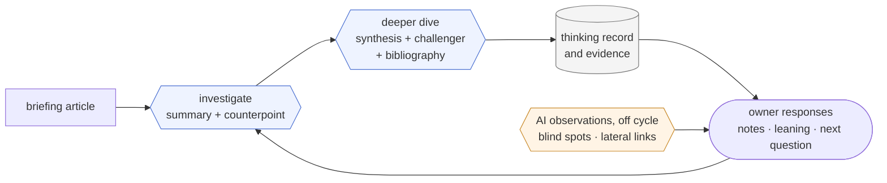

Feedback operates at two timescales. Immediate actions - likes, dislikes, saves,
and comments - help shape later article scoring. Research threads, deeper dives,
and recorded leanings preserve how an issue develops across sources and
sessions. The second loop is less mature than article selection, so the roadmap
and architecture describe its current limits.

### Language practice: conversation and return

German began with an upcoming trip to Vienna and a lack of opportunities to
speak before going. The domain addresses three practical gaps. First, I need
the experience of getting stuck and recovering in a real exchange. Second, I
want to read engaging, current material without the effort becoming burdensome;
contextual hints, translation, audio, and shorter excerpts help me keep moving.
Third, I want reasons to write about something I actually find interesting,
with correction and explanation for the mistakes I make. Gespräche, Lesen, and
Schreiben are complementary responses to those needs rather than separate
exercises.

The persona opens the exchange. The conversation is free-form, and difficulty
inside the conversation becomes evidence for later practice rather than a
reason to replace it with a scripted lesson. The approach was road-tested in
Vienna, where unexpected communication challenges could become new scenes to
relive later.

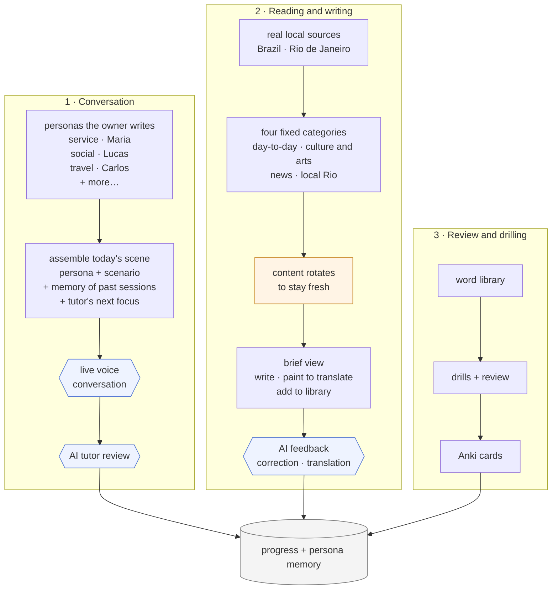

The figure uses Portuguese as the example: personas I write, a scene assembled
fresh for each session, real local reading from Brazil and Rio de Janeiro in four
fixed categories that rotate, and drills. German works the same way, with Vienna
as its local scene.

German came first and remains more developed in the backend, including the use
of reviewed conversation context in later persona prompts. Portuguese followed
to meet a family need: maintaining a second language used at home across
varying levels of proficiency. Each person begins with the same experience and
keeps a separate learning record. The domain remains level-agnostic: advanced
learners can choose more demanding scenes and language, while novices can rely
more on simpler scenarios, hover translation, vocabulary practice, and targeted
drills.

The two domains are intended to converge into the same solution from interface
through stored data and adaptive memory. A third language, new to the whole
family, will test that design directly: the language and content should change;
the solution should not.

### Lesen: reading, writing, and reuse

Lesen uses current German-language articles from subjects with an existing
reason to read: **Alltag** (everyday life), **Kultur** (culture),
**Nachrichten** (news), and **Wien** (Vienna and local life). A selected article
opens with a short excerpt drawn from the beginning of the source. The full
article remains available on its original site.

Translation help and other contextual hints are available without replacing the
reading. They keep unfamiliar language from turning an interesting article into
a burdensome decoding exercise. A highlighted word or phrase can be translated
and added to the Wörter library with its source sentence and article title. The
excerpt can also be expanded or read aloud.

Writing remains tied to the subject being read. A response can be typed or
dictated, and the correction step returns natural German, an English
translation, and short explanations of the changes. The corrected version can
be accepted or revised before saving. The archive retains the article, the
original response, and the corrected response; a drill record is saved with the
same work.

Lesen supplies the slower layers that real-time conversation cannot: close
reading, contextual translation, time to formulate a response, correction, and
deliberate review. Those layers develop recognition and recall in service of
better real conversation. Speaking exposes gaps; reading and writing provide
material and repetition; later conversation tests whether the language can be
retrieved.

## Continuity while the system changes

mini-moi is intended to keep its history even as the technology changes. Over
time, the useful part should be the knowledge gathered, lessons
learned, language practice, decisions, and some continuity of character from
daily interaction - not any particular model, memory system, interface, or
hosting arrangement. Provider memory can be used when it helps, while
application and local records keep that history from depending on one provider.

Domains give the work practical boundaries. Curator, the language domains,
Guild, and Chief of Staff each have a defined purpose and set of guardrails.
This reduces confusion about what a task is trying to accomplish and limits the
effect of mistakes. The boundaries can change: new interests may become
domains, while older areas may need less attention.

Curator and German were useful starting points because they supported real
interests and repeated use while also providing a way to learn AI by building
with it. Parts of the continuity loop already work, including Curator's article
selection, German's reviewed conversation memory, and Lesen's saved vocabulary
and corrected writing. Longer-term measurement and fuller coordination are
still being built. The aim is not to preserve today's components, but to let
mini-moi adapt without losing the history that makes it a more useful
collaborator. [ROADMAP.md](ROADMAP.md) records that boundary as it changes.

---

## How it is governed

These are mechanisms in the repository, each with tests. Where something is a
working rule rather than code, it says so.

- **Approval tiers.** Every mini-moi tool MC can call is listed in an
  owner-approved, digest-pinned policy with a tier; CoS's tools are a fixed,
  turn-bound set with receipts. Tier 1 reads. Tier 2 runs
  private, reversible writes under standing rules I have set. Tier 3 needs my
  exact approval for that one effect, every time: the platform shows a card with
  the exact text and a one-time code, reads my yes from my own message, issues a
  single-use grant, runs the effect through a fenced receipt, and reads the
  result back. An edited policy file approves nothing.
- **Spend limits per agent.** Each agent has its own gateway key limited to
  named model routes, with a spend cap and a rate limit. Production setup
  refuses to make a key without a cap. Helpers reserve their budget before each
  model call, inside small per-task and daily caps set in their charters. MC and
  CoS voice run under a daily budget.
- **A request ledger, not a chat.** Build and review requests are files: an
  immutable request and an append-only event log. A receipt means pickup, not
  completion; a result is the worker's report, not verification.
- **Model routes.** A route catalogue maps each task to a route, by tier and
  billing. Metered calls go through one gateway with a receipt per call, and a
  daily cost check reports and never changes a route.
- **A pipeline.** A push to main is classified by what it touched, tested, built
  into an image, and deployed behind container health checks. A
  documentation-only change restarts nothing. The whole suite runs nightly and
  files an issue when it fails.
- **A supervisor.** A separate container reports what has stopped and what is
  waiting on me, over Telegram. It approves nothing on my behalf.

Working rules, not code: a specification before a build, a reviewer other
than the author on every non-trivial change, usually from a different provider,
and my go before
a deployment. The pipeline deploys a merge to main after tests pass; the gate is
me, not the code. [ARCHITECTURE.md](ARCHITECTURE.md#design-principles) says where
each principle lives.

### Deployment

Production is one modest AWS EC2 instance, with Cloudflare in front through a
tunnel to the host: PostgreSQL, the model gateway, the five domains behind one
portal, the CoS agent and bots, and the CoS scheduler. The 1.2 layers (the task
service and helpers, the CoS Board, the supervisor, the Vault's search services,
Records and the Guildhall workers) are opt-in by design and on in production
today. MC is its own container stack, deployed on a release tag. Dev and staging
run on a second, smaller instance. My workstation (today a Mac) holds the
Vault's master shelf and runs delegated work. Backups run daily, local and
encrypted off-site, with a weekly second copy.
[ARCHITECTURE.md](ARCHITECTURE.md#runtime-topology) has the detail.

The maintained reference documents are:

- [ARCHITECTURE.md](ARCHITECTURE.md) - system design and the implementation as it stands (1.2 beta)
- [OPERATIONS.md](OPERATIONS.md) - how the production system runs (being revised for 1.2)
- [ROADMAP.md](ROADMAP.md) - current plans and the record of what shipped (being revised for 1.2)

---

## Design approach

Six choices explain most of the architecture; the full statement of each, and
where the code keeps it, is in [ARCHITECTURE.md](ARCHITECTURE.md#design-principles).

**Files first, database when needed.** Personal context lives in files owned by
the application, structured to match a later database schema. PostgreSQL holds
the Guild floor, every agent action and grant, supervision, the voice budget,
the Portuguese records, and a rebuildable copy of the research records whose
source stays in files. Append-only ledgers on disk are the
pattern for anything that must be auditable, and the Vault keeps agent memory as
plain files.

**Model-agnostic, by construction.** Callers ask for a task, not a model, and the
route catalogue makes a swap one line. Model choices are made by comparing the
same tasks across routes. The first version ran on a local model; local models
now stay on Dev and staging for regression runs, and production uses cloud
models only. The goal is an open-source model that passes the same tests.

**Platform-owned identity.** Domains never trust identity sent by the client;
the portal strips every client identity header and adds its own, and agents
receive a portal-signed assertion for one subject and one request.

**Agents act under policy, and I own the consequences.** The tiers, keys and
receipts above. I define the intent, decide what enters the system, and remain
responsible for the result. Claude Code, Codex and Grok contribute planning,
design alternatives, implementation, testing, and review; inside the product,
MC and CoS act only through the tools the platform exposes, with their own keys
and budgets.

**Agent-to-agent paths under approval, never autonomous ones.** Agents can ask
each other questions through the ledger, a partner can hand a chartered,
read-only job to its helper, and an approved delegation card lets a coding agent
run on my workstation in a fresh workspace with no push. Each is limited by a
charter, a cap, or a one-time approval. There is no path by which an agent
grants another agent authority.

**Operate while the system is evolving.** Drift appears between domains, between
code and documentation, and between assumed safeguards and the protection that
actually exists. Operations is a continuing process of observing production,
testing assumptions, and reconciling code and documents. This page and
ARCHITECTURE.md are checked against the code production runs before they are
published.

---

## Product tour

These production captures from July 21, 2026 show the domain environments and
several workflows behind their landing pages. They predate 1.2: the Guild and
Chief of Staff images show those domains before the partners went live, and a
1.2 capture set is still to come. Each image opens at full size.

### The domains

| Curator | Mein Deutsch |
|---|---|
| [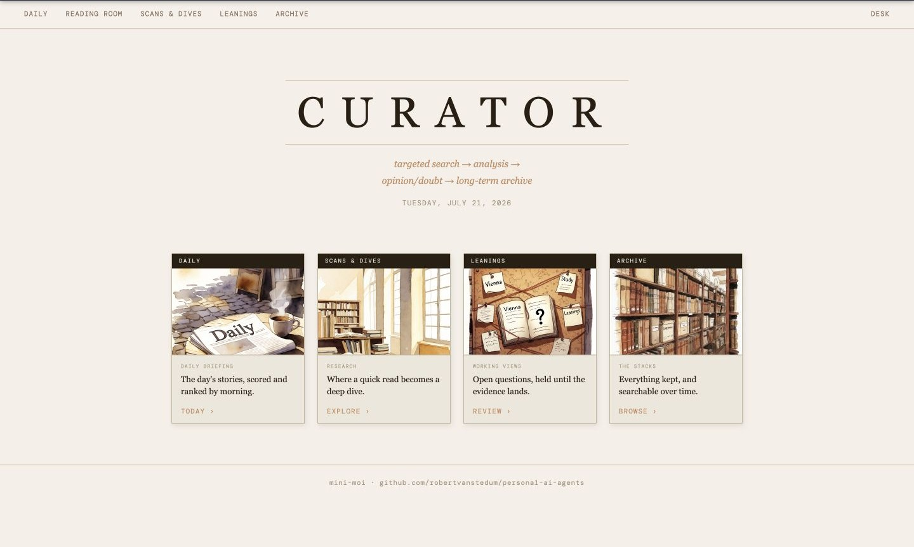](docs/screenshots/2026-07-21/curator-landing.jpg) |  |
| Daily reading, research, working views, and the long-term archive. | German conversation, reading, writing, and vocabulary in a place-based learning environment. |

| Meu Português | Guild | Chief of Staff |
|---|---|---|
|  | [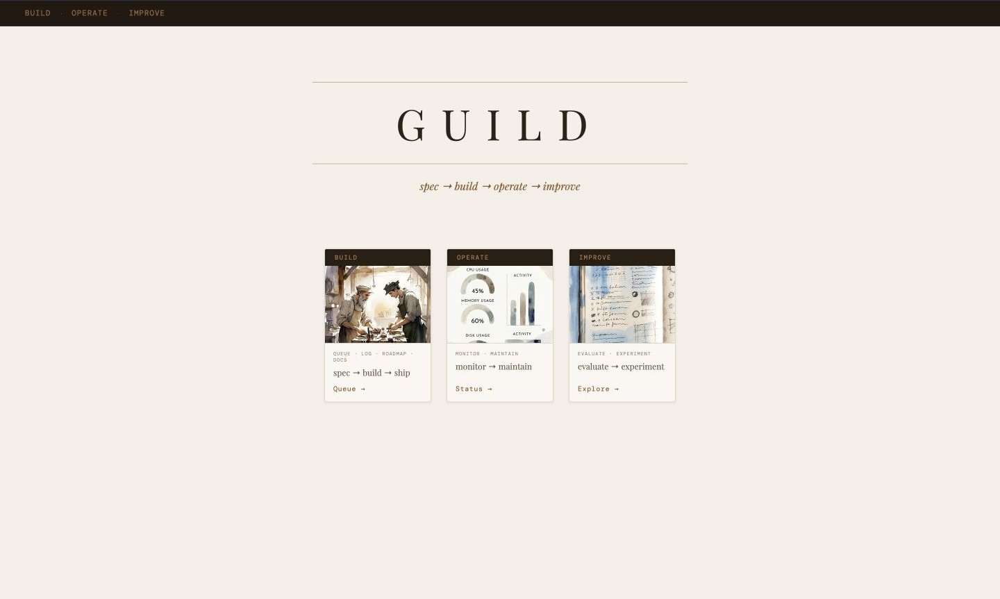](docs/screenshots/2026-07-21/guild-landing.jpg) | [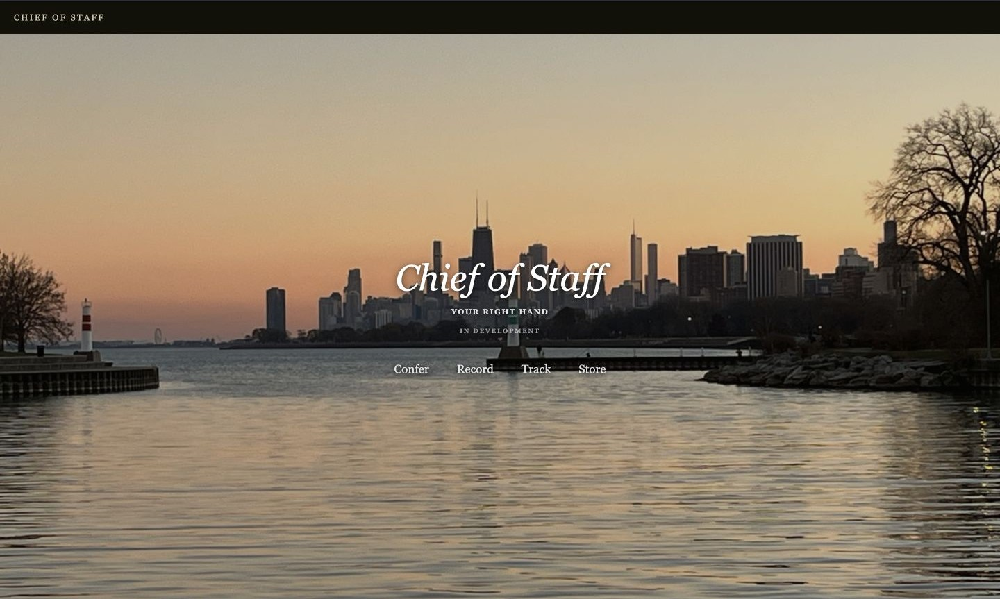](docs/screenshots/2026-07-21/chief-of-staff-landing.jpg) |
| Family Portuguese practice with separate learning records, level-agnostic immersion, and voice throughout. | Guild's Build, Operate, and Improve landing; Master Craftsman now works here. The image predates 1.2. | The Chief of Staff landing; the image predates the 1.2 partner release. |

### Curator: daily reading becomes research

The daily briefing is the beginning of the Curator loop, not the finished
product. A ranked article can be read quickly, used to provide feedback, scanned
for its argument and evidence, or turned into a larger investigation.

| Daily briefing | Article scan |
|---|---|
| [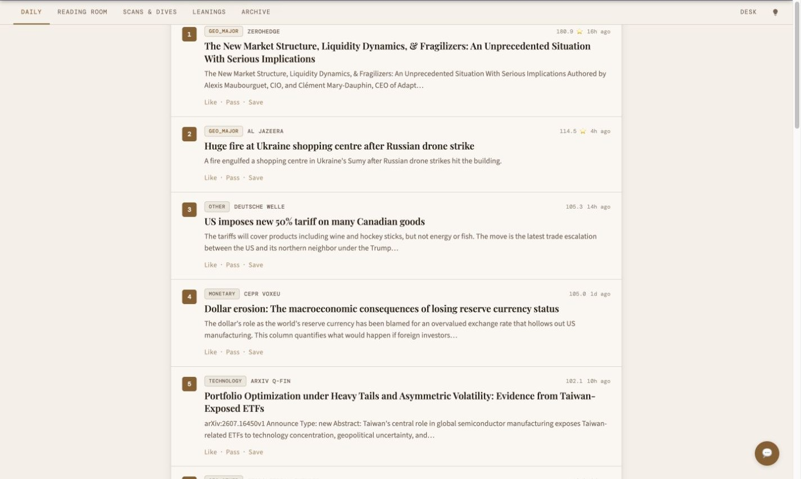](docs/screenshots/2026-07-21/curator-daily-briefing.jpg) | [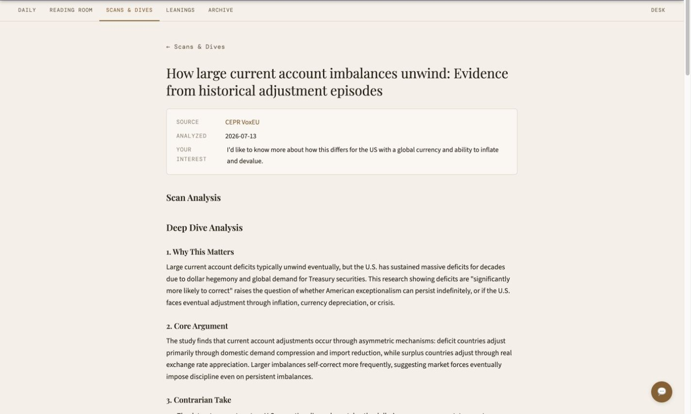](docs/screenshots/2026-07-21/curator-current-account-scan.jpg) |
| The morning selection ranks articles and keeps Like, Pass, and Save close to the reading decision. | The scan connects one article to the question that made it interesting, then extracts its argument, counterpoint, evidence, and next questions. |

| Research controls | Deeper-dive result |
|---|---|
| [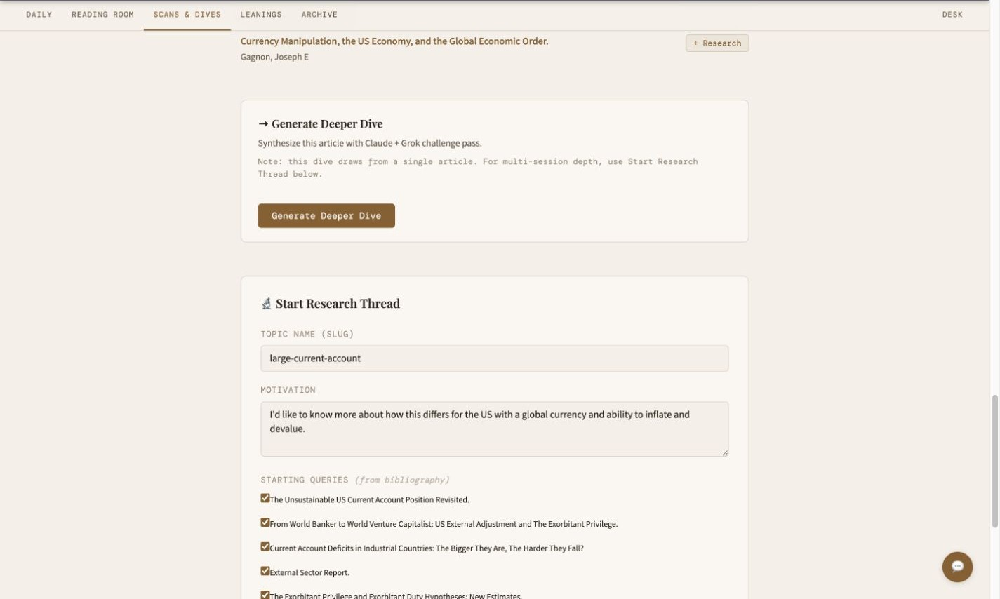](docs/screenshots/2026-07-21/curator-current-account-research-tools.jpg) | [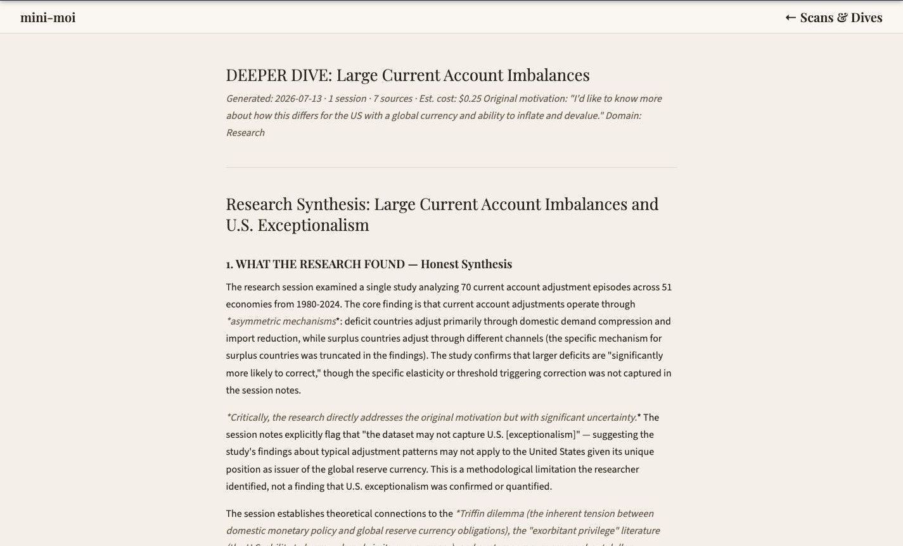](docs/screenshots/2026-07-21/curator-current-account-deeper-dive.jpg) |
| Bibliography items can seed further research; the article can also become an immediate deeper dive or a multi-session thread. | The completed synthesis states what the research did and did not establish, preserves uncertainty, and includes a separate challenge pass. |

### Language practice

The language interfaces use photography, personas, and real subjects to give
practice a setting and a reason. Correction and review remain attached to the
learner's own writing or conversation rather than becoming isolated exercises.

| German writing and correction | Portuguese conversation setup |
|---|---|
| [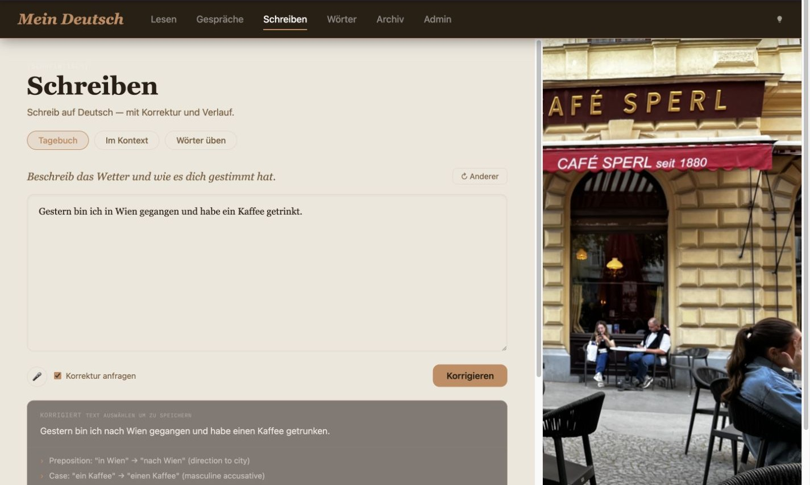](docs/screenshots/2026-07-21/german-writing-correction.jpg) | [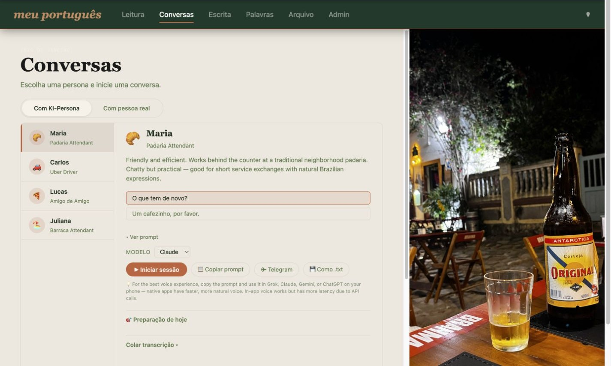](docs/screenshots/2026-07-21/portuguese-conversation.jpg) |
| A fresh demonstration sentence is corrected and explained without exposing a saved learning session. | A persona, scenario, model, and voice workflow prepare an unscripted Portuguese conversation. |

Earlier screenshots remain in [docs/screenshots/](docs/screenshots/) as part of
the project's history. Approved sets are grouped by date so a later visual
refresh can be added without overwriting this one.

---

## More detail

- [ARCHITECTURE.md](ARCHITECTURE.md): the thirteen figures, the two partners'
  runtimes, how the agents work together, how mini-moi remembers, voice, the
  model layer, runtime topology, delivery, identity, and the open items the code
  does not settle.
- [docs/runbooks/](docs/runbooks/): operating procedures for model tiers,
  supervision, the Vault, and the production agents.
- [docs/README.md](docs/README.md): working references and historical context,
  including the April 2026 platform vision.
- [docs/journal/](docs/journal/) and [docs/decision-records/](docs/decision-records/):
  the build narrative and the decisions behind it.

---

**Status:** 1.2 beta. In daily use since February 2026; on AWS since June 2026; release 1.2 in production beta since 9 November 2026.  
**Author:** Robert van Stedum
