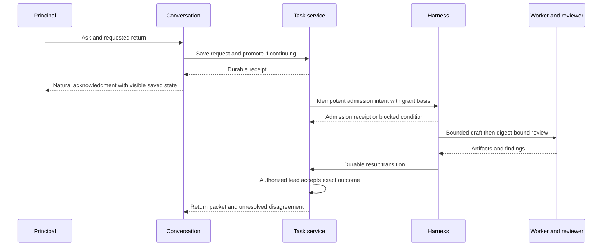

# MiniMoi partnership and team workflow specification

**Version 1.1 · 4 November 2026 · Application edition · Implementation baseline subject to closing code-feasibility review**

This specification defines the path from conversation to recorded work, bounded execution, review, acceptance and return. Its first delivery is an isolated synthetic foundation. Real unattended routes, cross-model policy activation, live migration and production rollout require their own approval and acceptance. Publication does not assert deployment or approve a resulting implementation diff.

Version 1.1 adds an end-to-end accountability and incident reconstruction contract (Q01–Q08) and F13–F16 acceptance. Existing requirement IDs and authority boundaries remain unchanged.

Normative requirements use MUST, MUST NOT and SHOULD. Requirement IDs bind implementation and tests. Provider protocols are optional adapters; internal state names do not assert A2A conformance.

## 1 Outcome and scope

**P01.** The principal can ask once and receive a useful result or an honest blocker without relaying artifacts or checking every step. Immediate requests, continued work and teams share one record contract.

**P02.** Responder, accountable lead, next-step holder and executor are separate responsibilities. Leadership is chosen per item. Registered seats can be served by different model runtimes; registering a seat does not grant capabilities.

**P03.** Included: conversation floor/corrections, durable requests/tasks, admission integration, review/acceptance, delivery, one-level supervision, private scope, Practice Book reuse and incident reconstruction. Excluded initially: arbitrary workflow authoring, autonomous lead replacement, graph migration, new provider transport standards and unrestricted background agents.

## 2 Authority map

| Record | Authority | Other components may do |
|---|---|---|
| Conversation event, floor, meeting minute | Records/conversation backend | Reference source event and request/task IDs |
| Request, task, lead/holder, outcome acceptance | Independent private task service | Query scoped views; submit authenticated commands |
| Attempt, grant, budget, lease, fence, execution outcome | Existing harness authority | Link exact execution references; never duplicate leases |
| Source/artifact edition | Domain/source artifact store | Reference immutable digest/edition |
| Review and accepted artifact set | Task records referencing immutable review artifacts | Show historical versus current validity |
| Recurring obligation occurrence | Existing obligation store | Link one recovery task per occurrence/intent |
| Lesson, approved practice edition | Existing learning/Pattern Book machinery, extended only where missing | Scope-filtered loading; no permission grants |
| Delivery/notice | Existing notice/outbox machinery | Report attempted/delivered/acknowledged separately |

**A01.** Task service MUST have a process lifecycle and durable data root independent of the CoS agent and Records. A container alone does not isolate host/storage failures. Reuse the existing single-writer/journal mechanism; repair replay consistency before extraction. Do not introduce a second execution controller.

**A02.** Every command MUST bind authenticated service identity to permitted seat, principal, environment, scope, origin and operation. A token or forwarded header alone MUST NOT confer owner authority. Platform, peer and model-authored messages MUST NOT be treated as owner instructions.

**A03.** Tool dispatch and disclosure MUST validate the current request/bundle, audience, capability, grant and applicable execution fence. Reads are scope-controlled. Peer/retrieved text is data. Discussion and action use the same logical seat identity/context and act only on the principal’s current request; any transport separation is an enforcement detail, not a second persona or user-facing turn kind. Restrictive discussion transport remains until equivalent enforcement passes negative tests for every affected seat.

## 3 Data contracts and lifecycle

All authoritative records have schema version, stable identity, environment/scope, revision, created/updated timestamps and provenance. Event time, saved time and delivery time are distinct. Unknown facts remain unknown.

| Object | Required information |
|---|---|
| Source event | Authenticated producer, stable source_event_id, durable ordering position, content/ref and correction target if any |
| Request | request_id, source_event_id, accepted intent/revision, interpretation_ref, responder, scope, provenance, disposition, coverage and result refs |
| Interpretation | interpretation_id/revision, source and correction refs, interpreting seat/session/runtime, concise proposed intent, supporting context refs/versions, disposition and authority basis; Q02 applies |
| Task | task_id, request_ref, lead, holder, outcome/done_when, return_window with timezone/basis, state/reason, parent_ref when used, execution/review refs, acceptance and events |
| Command | command_id, canonical payload digest, expected_revision, actor/seat, authenticated origin, basis_ref and scope |
| Transition | operation_id, payload digest, source/destination refs, source revision, fence/grant reference, apply/ack disposition |
| Artifact/review | immutable artifact set/digests, reviewer and reviewed set, findings/verdict/disagreement, provenance |

**D01.** `lead` owes the outcome; `holder` owes the next organizational step. Change lead only through explicit authorized reassignment. Holder changes follow an admitted sequence or authorized assignment; never silently obligate the principal. Child steps have their own assignees; parent holder coordinates. A speaking-floor change changes neither field by implication.

**D02.** One accepted request intent has at most one promotion. Refinements update the same request/task lineage. Explicit split/new outcomes get new linked identities. Request and task IDs may differ; both directions of the promotion link MUST be recoverable.

**D03.** Quick requests retain coverage, source editions and results in history without remaining on the open-work list. Any execution continuing beyond the current turn MUST have a task and admitted bounded plan, possibly single-step under an existing adequate grant. Saving history alone does not require task promotion.

### Required transitions

| Object | States and guarded transitions |
|---|---|
| Request | recorded → active → answered or failed; recorded/active → withdrawn; recorded/active → promoted with task link. Refinement appends revision and may reopen retrieval; historical results remain. Promotion does not erase results. |
| Task | submitted → working only on admitted work/pickup evidence; submitted/working → waiting with blocker/who-can-unblock; waiting → working only after the condition and authority are rechecked; working/waiting → completed only with current required review and lead acceptance. submitted → rejected with reason. Active states → failed or canceled with evidence and effects reconciliation. |
| Task reopening | Explicit authorized reopen of a terminal task creates a new revision; never automatic retry or erased history. |
| Review validity | pending → applicable only for exact reviewed artifact set; changed current digest → inapplicable-to-current; historical review preserved. |
| Acceptance | pending → accepted for exact artifact/outcome set by authorized lead; new current set requires new acceptance. Historical acceptance is never erased. |
| Transition | pending → applied-with-receipt → acknowledged; conflict/unknown holds; definitely absent permits same-ID retry only after revalidation. |
| Delivery | pending → attempted → delivered; failure/unknown remains reconcilable; read/acknowledged is separate evidence. |
| Practice | captured → proposed → approved edition or rejected; approved → superseded/retired only through the same owner gate. |

**D04.** Preserve failed versus canceled outcomes. Waiting reasons include input, authorization, dependency and unavailable lead. Wire-format names and any external mapping are pinned in the contract before implementation; mapping MUST NOT collapse unknown execution into failed/done.

**D05.** Task documents have conditional per-document revisions; existing stream ordering is not globally rewritten. Replay index/lookup MUST be correct across all authorized writer processes and restart. Same command ID/digest returns the original result; different digest is refused. Stale edits surface conflicts rather than silently adopting the newest revision and overwriting intent.

## 4 Conversation and presentation

**C01.** One responder by default. Clear explicit address overrides a stale picker. Unresolved conflict is clarified before consequential work. Floor stores only turn-taking state and authoritative subject reference/revision. Resolve current subject before dispatch. Topic change, expiry, departure and correction invalidate stale context.

**C02.** Default meeting convener is the available authorized lead of its main subject. Without one, use CoS when present in a principal-attended meeting; otherwise use the explicitly selected/initiating eligible participant. Agent-only work MUST already have a lead through its assignment. Never wait indefinitely for an absent default or confer capabilities by selecting a convener.

**C03.** Six controls: reroute identified request; pass floor/appropriate holder; hold speech/work disposition; withdraw identified request; step-back/wait; invite multiple contributions. Bind each to a target and revision; clarify ambiguous targets. Contributions do not duplicate execution. Report already admitted/sent effects honestly.

**C04.** In conversation display one primary status per subject: blocked/uncertain takes precedence, then current meaningful progress or readiness. Render the full fact ladder in inspectable detail, not multiple competing badges or narration. Keep speech natural, receipts visible and IDs optional in speech. No instruction to operate internal routing machinery.

**C05.** Persist actionable input before claiming it saved or dispatching. Source intake ordering precedes interpretation. Interim speech fragments are not independent actions. Receipt of words is distinct from durable request acknowledgment.

**C06.** Corrections before classification target the original source event and fence its old dispatch candidate; late interpretation must reconcile them. After persistence, conditionally amend the request/task. Scope/outcome/recipient/cancel changes invalidate stale dispatch until reconciled. Amendment fencing and effect admission MUST serialize at the execution authority. When cross-store communication fails say saved/pending reconciliation, not stopped. Effects already sent remain actual or unknown; no automatic replay.

**C07.** New messages may supersede unsaid replies, never persisted commitments by accident. Closing browser/chat/room leaves admitted work intact. Refusal to persist/verify is visible; no fabricated saved chip.

**C08.** The normal path MUST avoid an extra model call or correction round trip solely for fencing; lightweight identity/revision/authorization checks still apply to every dispatch. Measure p50/p95 source-ingress-to-durable-ack separately from inference and remote effects. Initial synthetic target: p95 ≤1 second on the recorded unloaded test environment; record baseline, sample size and overhead. A miss requires investigation and explicit disposition, never skipping durable save or policy checks. Real voice/mobile latency needs separate observed budgets before release claims.

**C09.** State a feasible return/checkpoint window for accepted continuing work. For “tomorrow,” proposed configurable default is the next verified relevant meeting tomorrow, else 08:00 in the principal's configured timezone. Persist absolute time and basis, say it for correction, and never invent a meeting. No promise of continuation without admission.

## 5 Promotion, transitions and execution

**E01.** Writer journals promotion intent with operation/payload IDs, expected request revision and reserved task ID. Pending links are not dispatchable. Recover the same intent to completion or definite non-application, not a second task. Readers cannot present partially committed linkage as complete.

**E02.** Source state plus outbox intent commits in the source transaction. Destination effect plus dedup receipt commits in its transaction before acknowledgment. Source marks acknowledgment only from verified destination evidence. This applies in both directions between tasks and harness. Do not pretend the two stores form one transaction.

**E03.** Reconcile applied/matching, definitely absent, conflict or unknown. Lost acknowledgments use operation lookup/dedup. Retry only a definitely absent operation with the same ID after revision, grant, scope and fence checks. Unknown remote effects hold; no new ID to evade uncertainty. Stale drainers cannot resurrect canceled requests or overwrite newer ownership. Restore/migration retains operation and fence history.

**E04.** Bundles enumerate seats, routes, steps, inputs, scope, budget, expiry and attempt/revision limits. Reuse harness claims/leases/generations, budget reservation and transactional next-step creation. Agent-only coordination requires an admitted plan, not an owner-shaped chat message or a room.

**E05.** Cross-model/cross-seat sequences are a later approved contract. If exact steps/routes are covered, routine continuation should not demand repeated owner relays; anything outside remains gated. This spec does not change current cross-family admission policy or enable a real route.

**E06.** Review artifacts cite exact input digests. Selecting a new current artifact set automatically invalidates current applicability of old reviews; preserve history. Acceptance and downstream release gates compare current/reviewed/accepted sets even if notifications lag. An explicitly pinned old edition stays valid only for that edition. Disagreement is delivered, never hidden as false consensus.

**E07.** Lead alone accepts the organizational outcome, subject to owner override. A worker’s done report is a submitted result; the child task remains nonterminal until its accountable lead accepts it. Lead may delegate one level with bounded context and grants. Reassignment/cancellation uses execution fencing and reports uncertain effects.

**E08.** Lead checkpoint failure records a blocked episode. Only already-admitted independent steps may finish within current bounds; hold steps needing lead judgment/acceptance/new scope. No autonomous substitute in the first slice. One durable needs-owner notice with delivery recovery; no repeated model wake-ups while waiting. Later alternates belong in reviewed seat charters and require explicit authority plus reconciled assignment/fence state.

**E09.** Judgment on stall/results needs an admitted slot/cap. Detection alone grants no model call, spend or reassignment. Notifications are deduplicated per episode with attempts and acknowledgment separate. Routine results remain at destination; urgent exceptions use existing explicit policy.

The diagram is a logical sequence; preparation of grant/owner confirmation occurs before admission. Conversation MUST NOT promise queued/working status from the save receipt alone.

## 6 Practice Book and controlled growth

**L01.** Reuse lesson/Pattern Book adoption and instruction-loading machinery. Closing review MUST identify what is actually implemented and what must be extended; a prior design is not proof that session loading receipts exist. No new service or separate approvals model.

**L02.** Capture lightweight lessons with incident/source references. CoS proposes a scoped card edition; the principal approves adoption, revision or retirement. Preserve immutable editions/history. Condense conflicting/stale cards; prevent unbounded context accumulation. A meeting close may offer one brief learning question; no mandatory model loop or forced lesson.

**L03.** Approved cards carry identity, content hash, scope, applicability, source refs, adoption evidence and version. Context assembly verifies approved current hashes and records seat/session, exact included hashes, assembly version and included/omitted/refused reasons. Receipt proves assembly/inclusion, not comprehension or obedience. Missing/mismatched cards are not claimed loaded; fail closed for any mandatory context condition and otherwise report omission according to charter policy. Re-check at new session or context refresh; old receipts do not prove a changed context loaded a new edition.

**L04.** Practices express preferred behavior, never authority. All grants and dispatch checks remain external. Seed templates are proposed content; real incident associations/adoptions remain private owner-approved data.

| Seed | Correct practice wording |
|---|---|
| Return window | State the expected return/checkpoint so the principal can correct it. |
| Receipt honesty | Without a verified receipt, do not claim saved. Reconcile an uncertain write before retrying. |
| Natural dialogue | Ask the human clarification; do not narrate routing machinery. |
| Disagreement | Deliver unresolved disagreement with evidence and the decision required. |
| Bounded investigation | Form one hypothesis, run one bounded test, inspect evidence before another; respect spend-stop limits. |
| Worker results | Treat a worker result as submitted until accountable acceptance. |
| Approval fatigue | Propose a reviewed bundle policy for repetitive approvals; never silently convert fatigue into permission. |

**L05.** A standing-authority register is a read-only view of existing grants/bundle policies: who, what, scope, budget, expiry and evidence. Escalations frame choices (resume/reassign/drop) rather than raw status. Repeated notice volume is diagnostic; aggregation MUST NOT suppress required safety/owner decisions or falsely acknowledge them.

**L06.** Scale by approved seats/scopes/charters, not new ledgers. Re-run isolation on each new seat/scope, validate capabilities on provider change, and gate authority widening with evidence and explicit policy review. Track manual relays, avoidable approvals, missed follow-ups, correction success, background spend and notice volume. Growth is not a calendar-driven autonomy toggle.

## 7 Migration and operating boundaries

**M01.** Operational records remain private. No task projection to GitHub. Published code/specs contain reusable definitions and synthetic examples only. Do not overwrite writable cloud stores through incidental synchronization.

**M02.** Keep recurring obligations authoritative for occurrences initially; one idempotent recovery task link, no duplicate chase/closure. At the organization-phase boundary the specification/acceptance lead recommends convergence and the principal decides.

**M03.** Preserve identifiers/aliases, history, receipts and unresolved ownership. `with`/`opened_by` alone does not establish accountable lead. Fence legacy writers before cutover. Post-cutover rollback requires reverse mapping/replay or freeze/reconciliation; a stale untouched folder is not a rollback. Prove consistent backup/restore first.

**M04.** Pin source and recoverability without blindly publishing private development ancestry. Isolated implementation need not require a main merge. Live configuration is verified separately; Compose defaults are not live-state proof. Feature rollback retains authority closures or disables affected capabilities safely.

## 8 Accountability and incident reconstruction

The system MUST let an authorized reviewer reconstruct instruction → interpretation → authorization → assignment → attempt → effect → review/acceptance, and identify duties that were missed. This is a chain of evidence and accountability across existing authoritative stores, not a new execution controller or competing audit database. Attribution distinguishes responsibility, observed action and causal findings; an assigned lead is not automatically the cause of a failure.

**Q01.** Every consequential operation MUST carry recoverable links to its initiating source or scheduled obligation occurrence, request/task when applicable, interpretation, authority basis, historical assignment, command and execution attempt. Evidence producers record stable event IDs, causal parent references, authenticated actor/seat, session/runtime identity, environment/scope, operation/target identity, revisions and event/recorded times. Runtime/model/provider/build/config versions MUST be captured where applicable; deterministic work identifies its implementation instead. Use causal links and per-store ordering rather than assuming wall clocks establish a global order. Quick actions retain this chain without requiring artificial task promotion. Child work links back to its parent and delegation authority. Runtime adapters attest observed identity and effects; model-authored identity or success claims alone are not evidence.

**Q02.** Preserve original instruction editions and corrections separately from each actionable interpretation. Record the interpreting seat/session, model/provider where applicable, concise proposed outcome and scope, supporting source/context editions and relevant instruction/policy/loading references. Record whether the interpretation was adopted for execution, corrected, rejected or left unresolved and by whom. Internal adoption of an interpretation MUST NOT be represented as human approval: reference the actual owner confirmation or pre-existing grant separately. Persist the interpretation before admitting its consequential action; corrections append a revision and apply C06 fencing. A concise decision record and evidence references are required, not hidden model reasoning or indiscriminate prompt capture. A load receipt proves inclusion only, not what caused a model's answer.

**Q03.** Preserve lead, holder, delegate, verifier and operational duty assignments with effective intervals, assignment source and authorized changes. A recurring operational obligation MUST identify the expected occurrence/window, schedule/threshold policy edition, responsible seat and required response/escalation. Record pickup, check time and scope, measurements, threshold evaluation, attempted remediation and notice delivery/acknowledgment, or an explicit missed/unknown state. An overdue occurrence without trustworthy check evidence MUST NOT appear healthy or fulfilled. Monitoring coverage includes its own last successful check; an unavailable monitor is a coverage gap, not evidence of health. Compare expected occurrences with receipts; this establishes missing evidence, not proof that an unobserved action never occurred. Reuse the obligation store and its recovery links; do not add a second scheduler.

**Q04.** Spending evidence links individual attempts, including failures/retries, to the initiating request/task/occurrence, executing seat/runtime/provider, applicable spending grant and reservation. Distinguish authorized cap, reserved amount, reported usage, estimated cost and provider-billed charge. Retain units, currency, estimate/rate version, source/time and provider request/transaction identifiers when available. Reconcile invoice/account adjustments, credits and aggregate charges without double counting; unsupported attribution remains explicitly unallocated or uncertain. Provider totals alone MUST NOT be presented as exact per-agent charges. Synthetic tests use fixture billing records; a real billing integration and reconciliation are separately evidenced before claiming real charge attribution.

**Q05.** Consequential dispatch requires durable intent, interpretation/authority references and the admitted attempt identity before the external effect. Record the exact authorized payload edition/digest and protected payload reference, destination, adapter request ID, external object/transaction ID, response/receipt and verification result as available. Verification records its actor and method; worker reports, independently observed effects and lead acceptance remain distinct. Never mark an operation successful solely because a request was sent. If post-dispatch recording fails or a response is lost, recover from the durable intent and external lookup using the same operation identity; report unknown and hold dependent work under E03. An audit failure cannot be hidden as success or authorize blind replay. Missing required pre-dispatch evidence blocks that dispatch.

**Q06.** Evidence history is append-only at the application boundary: corrections and reassignments supersede with reason/actor rather than rewriting prior claims. Scope checks cover audit lookup, export and referenced payloads; keep credentials out and private context in its authorized store. Use protected immutable editions, digests, existing journal ordering and independently retained checkpoints/backups to make integrity failures detectable. B0 MUST document which threats these controls detect and what remains trusted; hashes stored beside writable records alone do not prove resistance to a privileged rewrite. Restore validates evidence/link integrity and reports gaps. Initially retain history without automatic deletion. Any later retention/redaction policy requires explicit approval, access limits and preserved non-content tombstones/gap notices; do not promise reconstruction of deleted content.

**Q07.** Provide a scoped read-only reconstruction query/export, initially a CLI or API rather than a new dashboard. Starting from a request/task, external effect/charge reference or obligation occurrence, it returns the linked evidence and as-of assignments, interpretation and authority, attempts/effects, reviews, costs and outstanding gaps. Show evidence coverage and unavailable sources; distinguish observed facts, actor reports and investigative hypotheses. A non-author reviewer MUST be able to reconstruct the incident without asking the executing agent to remember. Record repair/remediation as linked new events. Audit access confers no execution authority and does not reveal the existence or contents of out-of-scope records.

**Q08.** Add evidence schemas/causal IDs and interpretation recording in B1A–B1E; joins to harness attempts, obligations and synthetic cost/effect receipts in B2. Meet synthetic F13–F16, including restore/link-integrity fixtures in B2, before declaring the synthetic end-to-end chain accepted. B3 separately proves migration and backup restore rehearsal. Extend the same contract to migration/practice evidence in B3 and prove provider-specific evidence coverage in B4 before claiming real operational or charge reconstruction. B0 MUST map implemented evidence fields versus missing instrumentation; existing logs are not proof of complete coverage. This requirement is part of the foundation, not deferred analytics work. No additional model call or user approval round is required solely to write evidence.

## 9 Acceptance matrix and release slices

| ID | Observable journey or fault | First evidence |
|---|---|---|
| J1 | Lookup, coverage gaps, refinement, next-session historical recall, no open-list clutter | Batch 1 synthetic corpus; real-source acceptance later |
| J2 | Draft → exact review → revision/disagreement → lead acceptance → return with browser closed | Batch 2 synthetic; real provider re-run in Batch 4 |
| J3 | Child failure/rejection, bounded revision, parent not auto-closed, cancel uncertainty | Batch 2 synthetic; real workers later |
| J4 | Technical lead supervises admitted cross-model overnight builds without a room or human relays | Batch 4 only after separate admission/route approval |
| F01 | Crash at each promotion intent/link/receipt boundary; duplicate/different command digest | Batch 1 |
| F02 | Destination commits but acknowledgment lost; stale drainer after cancel/reassign | Batch 1/2 |
| F03 | Correction before classification, after persistence and before/after effect admission | Batch 1/2 |
| F04 | New digest before late review or concurrent lead acceptance | Batch 2 |
| F05 | Lead absent, principal absent, notice delivery down; no unauthorized successor | Batch 2 |
| F06 | Platform/peer text, forged headers, expired grant, read/disclosure scope refusal | Before any replacement tool-capable path |
| F07 | Two writer processes, stale edit, kill mid-write, coherent restore | Batch 1 and migration rehearsal |
| F08 | Meeting close partly saves; receipts reconcile without duplication | Batch 3 |
| F09 | Migration rollback after new writes; unresolved lead preserved | Batch 3 rehearsal before live approval |
| F10 | Practice proposed/approved/revoked/mismatched; exact context-load receipt and no new authority | Batch 3 |
| F11 | CoS/Records outage leaves task service available within stated host limits | Batch 1/3 |
| F12 | Per-seat voice identity, audio-floor isolation, physical barge-in and stop-vs-cancel | Separate advertised voice gate |
| F13 | Unexpected synthetic charge: reconstruct authorized cap, failed/retried attempts, executor/provider, estimate versus billed fixture and unallocated/aggregate adjustment without invented attribution or double count | B1 evidence contract; B2 complete synthetic; B4 real coverage |
| F14 | Missed disk check: reconstruct expected occurrence, owner at that time despite later reassignment, missing/late measurement, threshold and escalation/delivery; monitor outage and missing receipt never imply healthy | B1 evidence contract; B2 synthetic obligation adapter |
| F15 | Wrong issue interpretation: reconstruct original instruction/correction, interpreter/context, adopted intent versus actual authority, exact synthetic payload/effect and review; show where divergence first becomes observable and test fencing before dispatch | B1 interpretation/fencing; B2 full synthetic chain |
| F16 | Missing/corrupted evidence, denied audit access, pre-dispatch recording failure, post-effect receipt loss, restore and unavailable store: expose gaps, refuse unsupported claims, preserve uncertainty and prevent duplicate effects | B1 storage/access; B2 joined recovery and synthetic restore/link-integrity fixture; B3 migration/backup restore rehearsal |

Synthetic passes MUST be labeled synthetic. No production claim, real-data completeness claim or unattended-provider promise follows from them. Final implementation approval uses actual diffs and evidence; deployment and paid-route activation remain distinct decisions.
